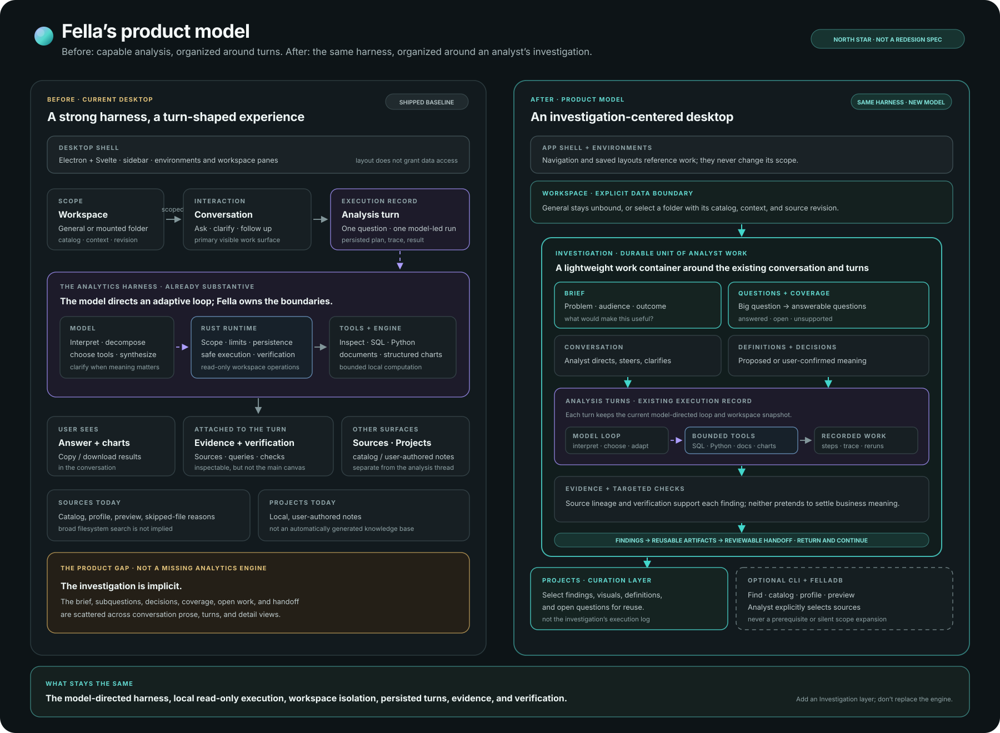

# Fella product vision and foundations

**Status:** North-star product definition, synthesized October 2026. This is a
product direction, not a claim that every described capability ships today or
a dated delivery commitment. For current behavior, use [Product](PRODUCT.md)
and [Architecture](ARCHITECTURE.md); for sequenced work, use [Roadmap](ROADMAP.md).

## The product in one sentence

**Fella is an AI analytics harness for analysts working with files: it helps
carry a real question from data discovery through a steerable,
evidence-backed investigation to a result that can be reviewed and handed
off.**

“AI analytics harness” names the product category and its technical thesis.
The human-facing promise is an **AI analyst for file-based analytical work**.
Fella is not valuable merely because a model can write SQL or summarize a
spreadsheet. Its value is the system around the model that scopes data,
discovers what is available, supports computation, preserves evidence, exposes
uncertainty, and helps the analyst judge and communicate the result.

## Why Fella should exist

Analysts often receive a business question before they receive a clean data
model. The useful inputs may be exports, spreadsheets, logs, reports, or
documents collected in a folder. Before answering, an analyst has to discover
what is there, learn how it is shaped, decide what the question means, choose
and run a method, check the result, explain the limitations, and give someone
else something they can use.

That work is real analysis, even when it happens outside a warehouse, notebook,
or BI project. A general chat model can suggest an answer, but it does not by
itself provide a reliable boundary around the files, a controlled way to
compute, a durable record of what happened, or a clear distinction between
executed checks and business judgment.

Fella exists to make that messy, often ad hoc analytical work more capable
without making it less inspectable. **The model supplies flexible analytical
judgment; the harness supplies scope, tools, execution, continuity, and
evidence.** The analyst remains responsible for the question, consequential
definitions, and whether the result is fit to share.

The **primary user** is the analyst doing exploratory or ad hoc work on data
that has not yet been shaped into a governed analytics environment. A project
manager, operator, or decision-maker may be the requester and recipient of the
answer, but the analyst is the person Fella must empower to frame, inspect,
correct, and defend the work.

## The analyst’s job

Fella is for analysts who need to answer questions using local, imperfect, or
not-yet-modeled data. Their job is not simply “ask a question and get a chart.”
They need to move through a lifecycle that can take an afternoon, a week, or a
month:

| Analyst work | What Fella should make possible |
| --- | --- |
| 1. Get the problem | Capture the question, the decision or need behind it, the intended audience, and what a useful answer must cover—without turning every quick question into a long intake form. |
| 2. Discover available data | Establish the explicit workspace scope; reveal relevant sources, structure, quality signals, exclusions, and unsupported inputs. |
| 3. Decompose the big question | Propose answerable subquestions, their order where it matters, and the definitions or ambiguities that could change the outcome. Let the analyst correct the framing. |
| 4. Answer the smaller questions | Track which questions have evidence-backed findings, which remain open, and how their results contribute to the original problem. This may take several turns or sessions. |
| 5. Build the query or method | Choose an appropriate route—SQL, bounded Python, document inspection, or a combination—and make the consequential inputs, query/calculation, and assumptions inspectable. |
| 6. Run the analysis | Execute against the intended scope with bounded, read-only capabilities; retain useful outputs and their source/revision lineage. |
| 7. QA the query and result | Check execution and data invariants, show what each check establishes, map evidence to the requested coverage, and surface what still needs analyst judgment. |
| 8. Build the visualization | Turn supported results into an appropriate, reusable chart or table with clear framing and links back to its data and method. |
| 9. Hand it to the requester | Provide a concise reviewable result with scope, definitions, method, findings, visuals, checks, caveats, and unresolved questions—not just a copied answer bubble. |

**Continuity crosses every stage.** The investigation may take a week or a
month. The analyst needs to return, see the brief and current state, know which
workspace revision prior turns used, identify stale results, and continue
without reconstructing the work from a transcript.

This is a product lifecycle, **not a fixed sequence of model tool calls**.
Fella should let the analyst move backward, skip irrelevant work, ask for
clarification when it matters, and pursue new questions discovered during
analysis. Its workflow should feel like an analyst’s work while remaining
adaptive to the data and the problem.

## The product story

The story should be demonstrated through one coherent job, not a gallery of
unrelated AI features:

> An analyst receives a question and a folder of unfamiliar files. Fella helps
> establish what is in scope, what the data can answer, and which assumptions
> matter. It investigates with suitable tools, makes its intermediate work
> inspectable, checks what it can check, and assembles supported findings and
> visuals. The analyst can correct the interpretation, see what remains
> unresolved, and hand the result to the person who asked.

The product’s memorable promise is not “analytics by chat.” It is **a model
that can do analytical work inside a purpose-built harness, while the analyst
can see and steer the work**.

The diagram summarizes the current desktop and the target model. The target
adds a durable Investigation layer around the existing conversation and
analysis-turn machinery; it does not replace the analytics harness.

The canonical definitions, ownership rules, lifecycle semantics, and mapping
to the 42 implementation issues live in the [Fella product model](PRODUCT-MODEL.md).



## Product identity and boundaries

### Fella is

- An **AI analytics harness**, with the model directing an adaptive analysis
  and the runtime enforcing scope and execution boundaries.
- A **file-native analytics product** for questions that begin with ordinary
  local files rather than a prepared warehouse or dashboard.
- An **analyst workflow**, where discovery, interpretation, computation,
  verification, visualization, and communication belong to one connected
  piece of work.
- A **human-steerable system** that makes consequential choices, evidence,
  checks, and limits available for review.

### Fella is not

- A general-purpose computer-control agent or an unrestricted shell agent.
- A replacement for every warehouse, notebook, spreadsheet, or BI system.
- A fixed wizard that forces every analysis through the same checklist.
- A chat transcript presented as a durable investigation.
- A claim that a successful query, passing replay, or generated chart proves
  that the business interpretation is correct.
- A whole-computer search product by default. The desktop’s current analysis
  scope is explicitly selected; broader personal-library discovery belongs to
  an optional, explicitly scoped CLI/FellaDB direction.
- An automatically generated wiki or dashboard today. Projects are currently
  local user-authored notes, and the curated knowledge layer remains a future
  direction.

## The foundational primitives

A Fella primitive is a domain object with an identity, a scope, a lifecycle,
and clear ownership. It is not merely a screen, message, or visual component.
The product needs both **analyst-work primitives** and **interface-composition
primitives**; they must not be conflated.

### Analyst-work primitives

| Primitive | Definition and responsibility | Current footing |
| --- | --- | --- |
| **Workspace** | An explicit analysis boundary: General or a mounted folder. It owns the applicable catalog, context, memory, conversations, and workspace identity. It is not an environment tab or pane arrangement. | Workspace identity, catalog, revisions, and scoped state exist. |
| **Source** | A cataloged file, workbook sheet, or document available within a workspace. Its useful identity includes its workspace-relative identity and the revision/profile used for analysis, not just a display name. | Catalog entries and source profiles exist; supported and skipped inputs are represented. |
| **Investigation** | The durable aggregate for one workspace-scoped analytical conversation. It owns the identity and lifecycle of that work and links its brief, source-scope choices, Questions, decisions, analysis turns, Findings, unresolved work, and handoff state. It references those records rather than copying transcripts, execution traces, or evidence payloads into itself. | **Missing as a first-class object.** Today this work is split between a conversation archive and separate turn records. |
| **Question** | The original request or a decomposed question that contributes to resolving it. Questions can be open, active, answered, blocked, or awaiting a decision; dependencies should be recorded only when they help the analyst. | A turn has a question string and the model may decompose work, but there is no durable question tree or coverage state. |
| **Conversation** | The interaction thread for asking, clarifying, directing, and reviewing. It has one stable workspace scope. In the initial model, each workspace-scoped analytical conversation has exactly one Investigation; General conversations remain unbound unless the user explicitly selects a source or scope. | Persistent conversations and clarification continuity exist. |
| **Analysis turn** | One bounded execution of a question: its input, workspace snapshot, interpretation/contract where present, plan, tool activity, result, evidence, verification, and rerun lineage. This is the unit to inspect and replay. | A canonical persisted turn already exists. It is currently the closest thing Fella has to a durable work object. |
| **Step** | A meaningful operation within a turn—such as inspecting a source, querying, calculating, checking, or producing a chart. A step should show its purpose, relevant inputs, result, and status without exposing private model reasoning. | Tool traces and evidence approximate steps, but they are not yet a durable, analyst-operable work surface. |
| **Definition / decision** | A scoped semantic choice: for example, what counts as an active customer, which date defines a month, or how missing values are handled. It records its authority—observed, model-proposed, user-confirmed—and where it applies. | Per-turn analysis contracts and workspace semantic memory provide partial support; case-specific decisions are not a first-class investigation record. |
| **Evidence** | A source- and revision-linked observation or computation result, including the method and relevant output. Evidence substantiates or challenges a finding; it is not the model’s prose about the evidence. | Typed evidence, provenance, source references, and verification findings already exist. |
| **Finding** | A concise answer to a question, represented as a claim with supporting evidence, checks, caveats, and a state such as supported, qualified, or unresolved. | Findings currently appear primarily as generated answer prose rather than stable typed objects. |
| **Artifact** | A reusable output—such as a chart, table, or brief—linked to the finding, evidence, method, scope, and revision that produced it. | Structured charts and exports exist within answers; independent artifact identity and a complete handoff package remain future work. |
| **Project** | An optional curation layer that gathers selected findings, artifacts, definitions, and open questions into reusable knowledge. It curates completed or ongoing investigations; it does not replace their execution history. | A repository-local, user-authored notes/wiki surface exists. Automatic evidence-backed curation is a direction, not current behavior. |

### Interface-composition primitives

**Environment**, **workspace pane**, and **surface** organize where existing
work appears. An environment arranges references to workspaces; a pane places
one workspace and selected conversation; a surface points to an existing
conversation, chart, source preview, or analysis detail. These objects change
presentation, not data permissions, evidence, or analytical ownership. The
[composable-interface contract](COMPOSABLE-INTERFACE.md) remains the source of
truth for their current interaction rules.

### Object relationships

```text
Workspace ──contains──> Sources and workspace-scoped definitions
    │
    └──> Investigation (one per workspace-scoped conversation)
           ├── brief, source-scope choices, Questions
           ├── Decisions and unresolved choices
           ├── one Conversation ──contains──> Messages
           ├── Analysis turns (one conversation may span many turns)
           │      └── Steps ──produce──> Evidence and verification
           └── Findings ──supported by──> Evidence
                    └── render as──> Artifacts

Project ──curates selected──> Findings, Artifacts, Definitions
Environment / Pane / Surface ──reference existing objects; own no analysis
```

### Investigation record contract

For the initial desktop model, an Investigation is the durable anchor for one
workspace-scoped analytical conversation—not a container that duplicates all
of its data. Its minimum identity is:

- **`id`** — stable for the lifetime of the Investigation; never derived from
  its editable title or its position in the UI.
- **`workspace_ref`** — points to exactly one Workspace. The Investigation
  cannot silently move to another workspace; work in a different workspace
  starts a separate Investigation.
- **`conversation_ref`** — points to exactly one Conversation in the initial
  model. That conversation can continue across sessions and contain many
  turns. This association is created automatically for workspace analysis;
  General remains unbound unless the user explicitly scopes it.
- **`title`** — a compact, user-editable label for finding the work again; it
  is not the source of identity or analytical meaning.
- **`status`, `created_at`, `updated_at`** — minimal lifecycle metadata. The
  lifecycle issue defines what each status means; a status must not be inferred
  merely from whether the latest run finished.

The Investigation owns its identity, workspace boundary, conversation link,
and overall lifecycle. Brief, Questions, source-scope decisions, analysis
turns, Findings, and Artifacts remain their own concepts and are linked to the
Investigation as their definitions are established. Transcript messages,
execution traces, evidence payloads, and verification details remain owned by
their existing records. The Investigation may summarize or index them, but it
must not become a second source of truth for their contents.

The intended distinction is: **Investigation is the unit of work;
Conversation is the unit of interaction; Analysis turn is the unit of
execution; Step is the unit of inspectable activity; Evidence is the unit of
support; Finding is the unit of conclusion; Artifact is the unit of reuse.**

This is a shift in emphasis, not a replacement of conversation. The current
app makes the conversation the durable interaction unit. The target makes the
Investigation the durable domain unit while keeping conversation as the
natural way to direct and discuss the work. Every workspace-scoped analytical
conversation receives a lightweight Investigation automatically, including a
quick one-question exchange. Its record stays small until the work needs more
structure; Questions, decisions, Findings, and handoff details accumulate as
the analyst uses them. This adds no creation ceremony and avoids a disruptive
promotion step. General remains outside this association unless explicitly
scoped by the user.

For an initial investigation model, keep one explicit workspace scope at a
time and make that scope stable for the Investigation's lifetime. A different
workspace starts a different Investigation; a changed source revision within
the same workspace is made visible and recorded on the affected turn. A future
multi-workspace investigation should be an explicit product decision, not an
accidental side effect of arranging panes.

## The target analyst experience

The analyst should be able to enter through a simple question or **Check
data**. Every workspace-scoped analytical conversation gets a lightweight
Investigation record automatically, while the interface reveals more structure
only when the work warrants it. A small question should still feel lightweight;
a multi-part, consequential, or long-running request should accumulate useful
Questions, decisions, and Findings without forcing the user to rebuild context.

An investigation should make the following legible and steerable:

1. **Brief:** What is being asked, who needs the result, and what decision or
   outcome it supports.
2. **Scope:** Which workspace and source revision are in play; what is
   available, excluded, skipped, or unsupported.
3. **Questions:** How Fella currently understands the request and what parts
   it proposes to answer. The analyst can correct the framing.
4. **Definitions and decisions:** Which interpretations could materially
   change a result, who supplied them, and whether they are settled.
5. **Work in progress:** The relevant inspection, query/calculation, result
   preview, and next step. Show useful method and outputs, not raw internal
   reasoning or decorative activity noise.
6. **Coverage and QA:** Which parts of the brief have evidence, what checks
   actually ran, what those checks establish, and what remains untested.
7. **Findings and visuals:** Conclusions connected to evidence, caveats, and
   audience-appropriate charts or tables.
8. **Continuity and handoff:** What changed since the last visit, whether
   prior evidence is still current, what remains open, and what can be shared.

This borrows the *inspectability* of notebook workflows without making Fella a
Jupyter clone. The analyst needs control over the investigation, not a general
kernel, arbitrary package ecosystem, or a forced cell-by-cell interface. The
notebook-inspired direction and its limits are recorded in
[Stack vision](STACK-VISION.md).

## Trust and control model

The model should be capable of interpreting an ambiguous request and choosing
an appropriate investigation. Fella’s runtime must make that capability safe
and inspectable. The boundary is:

| Responsibility | Owner |
| --- | --- |
| Interpret intent, propose decomposition, choose a suitable analysis route, synthesize findings | Model, guided by the user’s request and available context |
| Select and enforce workspace scope, expose bounded tools, execute SQL/Python/document operations, manage persistence and resource limits | Fella runtime |
| Record source/revision lineage, execution outputs, and target-scoped verification findings | Fella evidence and verification systems |
| Resolve consequential business meaning and decide whether the result is fit to share | Analyst, with Fella surfacing the choices and evidence |

The UI should distinguish at least four kinds of information:

- **Observed:** what the catalog or a tool directly returned.
- **Computed:** what a recorded operation calculated from specified inputs.
- **Proposed:** what the model inferred or recommends, including uncertain
  definitions.
- **Confirmed:** what the user or analyst explicitly accepted as meaningful.

These categories must not collapse into one confidence badge. A query can run
successfully and still answer the wrong question. A deterministic check can
validate a result property without validating the business definition. A
model-proposed relationship must not silently become a confirmed fact. Prior
conversation prose can help with continuity, but it is not fresh evidence.

Core invariants:

- Every data-backed operation has an explicit workspace and source revision.
- General stays unbound unless the user explicitly selects a source or scope.
- Source files are read-only to analysis. Exporting a derived result, if
  supported, is a separate deliberate action.
- Source discovery does not silently grant analysis access; the analyst chooses
  what becomes part of an investigation’s scope.
- Evidence retains enough lineage to inspect how it was produced.
- Verification findings state what they checked and which claim, result, or
  artifact they affect. They never imply more than the check establishes.
- When a workspace changes, old work is retained and marked stale where
  appropriate; it is not silently rebound to new data.
- Hosted model providers may receive the prompt and selected context or
  file-derived tool results. “Local analytics” must not be presented as
  “local inference.”
- The model may direct the work; it does not acquire unrestricted filesystem,
  shell, network, or write access by implication.

## Product shape and adjacent layers

The desktop analysis harness is the center of Fella’s product identity. Other
layers may strengthen it, but none should obscure or be prerequisites for the
core analyst story.

| Layer | Job | Status and relationship |
| --- | --- | --- |
| **Fella desktop** | Investigate an explicitly selected local workspace through a model-directed, inspectable analytical loop. | Shipped foundation and primary product. The next product-level step is to make the investigation—not just the answer turn—legible and durable. |
| **Fella CLI** | Offer direct analyst operations such as search, catalog, profile, preview, and read-only query. | Proposed optional tooling. It should share source identity and provenance with the desktop, not become a prerequisite for using the harness. |
| **FellaDB** | Provide a persistent, local filesystem search/index capability for the CLI and, with explicit user intent, General discovery. | Proposed capability within the CLI direction; not a second analytics database or an implicit whole-disk scanner. Embeddings may be optional, not required for the base product. |
| **Projects** | Curate selected findings, visuals, definitions, and open questions into knowledge that can be revisited or shared. | Existing Projects are local user-authored notes. Evidence-backed generated curation is a future knowledge layer, downstream of trustworthy investigations. |

The shared foundation across these layers is not a shared screen. It is stable
workspace/source identity, revision-aware provenance, semantic definitions,
and typed links from discovery through analysis to reusable findings. See
[Filesystem-to-analysis stack vision](STACK-VISION.md) for the exploratory
CLI/FellaDB boundaries.

## What is strong today, and what is missing

Fella already has a substantive technical foundation: folder cataloging and
source profiles; read-only SQL; bounded Python; document search/read; structured
charts; clarification and conversation continuity; typed evidence and
provenance; analysis-turn persistence; and deterministic, target-scoped
verification. The model directs an adaptive loop, while the Rust runtime owns
execution and capability boundaries. These are the foundation of the product,
not implementation trivia.

The largest gap is the mismatch between **analyst-shaped runtime behavior**
and a **turn-shaped user experience**. Today, users can ask, inspect sources,
receive answers and charts, and open analysis details. They do not yet have a
durable case that connects the original brief to the evolving questions,
definitions, work, coverage, unresolved issues, findings, and eventual handoff.

| Capability | Today | Product direction |
| --- | --- | --- |
| Data discovery | Folder catalog, profiles, previews, skipped-file reasons, and Check data | Make discovery a continuing, revision-aware part of an investigation; keep broad filesystem search optional and explicit. |
| Framing | Model can inspect, decompose, clarify, and form an analysis contract | Show an editable brief/question structure and material definitions without requiring approval for every routine inspection. |
| Computation | Model-directed SQL, sandboxed Python, document operations, and structured charts | Make meaningful steps and previews inspectable while they run, and let users steer or correct the work. |
| QA | Deterministic execution/evidence checks and displayed findings | Add request coverage: map each question to findings, evidence, checks, caveats, and unresolved items. Keep semantic judgment human-owned. |
| Visualization | Charts in answers with copy/download paths | Treat visuals as reusable artifacts with titles, interpretation, exact data, method, and provenance. |
| Continuity | Conversations, turn history, workspace memory, and revision-aware evidence | Add a durable investigation state that survives time and multiple runs without treating transcript length as project management. |
| Handoff | Answer and chart/data exports; evidence remains inspectable in the app | Assemble a concise reviewable brief that carries scope, definitions, method, findings, visuals, checks, caveats, and open questions. |
| Reusable knowledge | User-authored Project notes | Curate selected, reviewed, provenance-linked findings after the investigation workflow is trustworthy. |

The static workflow audit provides the detailed current-state evidence and
limitations: [Analyst workflow audit](ANALYST-WORKFLOW-AUDIT.md). Its findings
are a code-and-document review, not a live user study or proof of analytical
quality.

## Product principles

1. **The investigation is the product, not the prompt.** Optimize for carrying
   analytical work to a useful conclusion, not only for generating a plausible
   first response.
2. **Start from the data, not assumptions about the data.** Make discovery,
   unsupported inputs, and quality visible before claiming coverage.
3. **Stay adaptive, keep the model-directed loop.** Do not turn the analyst’s
   lifecycle into a rigid chain of mandatory screens or tools.
4. **Make meaningful work visible.** Expose interpretations, selected scope,
   methods, intermediate results, checks, and caveats at the point they help a
   person steer or judge the outcome.
5. **Ask at consequential ambiguity.** Automate routine, reversible inspection;
   ask the analyst when a choice could materially change the answer.
6. **Separate evidence from interpretation.** Preserve the distinction among
   source observations, computations, model suggestions, and user-confirmed
   meaning.
7. **Preserve scope and provenance.** Every result must say what data and
   revision it came from; view arrangement must never change access.
8. **Design for return and handoff.** Analytical work has a lifecycle longer
   than one chat session and an audience beyond the person who ran it.
9. **Keep the product focused.** Add tooling only when it strengthens the
   analyst’s file-to-answer workflow; avoid becoming a generic agent platform,
   file manager, or dashboard builder.
10. **Earn trust through measured capability.** Product claims should follow
    broad, implementation-independent evaluation—not isolated demos or
    successful execution alone.

## A coherence test for product decisions

Fella’s product should keep reinforcing the same small set of ideas:

- **Promise:** carry an analytical question about files toward a result that
  can be reviewed and handed on.
- **Central work object:** the Investigation connects the brief, questions,
  decisions, runs, findings, and open work.
- **Operating model:** the model directs an adaptive investigation; the
  harness scopes, executes, records, and checks it; the analyst steers
  consequential meaning.
- **Proof:** important findings link back to source revisions, computations,
  checks, and caveats.
- **Experience:** the interface gives the analyst a clear view of the work in
  progress and its useful outputs—not an unrelated feature gallery or a
  generic canvas.
- **Extensions:** CLI/FellaDB can improve discovery and Projects can preserve
  knowledge, but both should reuse these same scope, meaning, and provenance
  primitives and remain optional to the core desktop workflow.

A proposed feature is coherent when it strengthens at least one of these
ideas without weakening the others. If it broadens access, hides provenance,
or adds a new destination disconnected from investigations, it needs a clear
user problem and an explicit boundary before it belongs in the product.

## Product-building sequence

This sequence expresses dependency and product logic, not dates or a promise
that every layer will be built:

### 1. Protect and measure the foundation

Continue broadening independent analytical evaluation across domains, file
families, ambiguity, cross-file work, QA, charts, and follow-ups. Report
interpretation quality, answer coverage, evidence support, clarification,
chart semantics, resource use, and false deferrals separately. Preserve
failures and benchmark versions; do not tune the grading contract to the
implementation after seeing its output.

### 2. Give long-running work a home

Introduce the lightest useful Investigation and Question objects. Create one
automatically for each workspace-scoped analytical conversation, then let its
structure grow only as needed. Preserve the brief, scope, question progress,
decisions, linked turns, and open items without adding a setup step to simple
analysis.

### 3. Make the analytical method steerable

Show the live interpretation, selected sources/fields, consequential
definitions, useful query/calculation outputs, and next action. Let the user
correct a material assumption, interrupt, or continue. Show meaningful steps,
not every internal token or low-value tool event. Keep it notebook-inspired,
not a notebook clone.

### 4. Connect QA to the question

Retain deterministic verification, then make coverage visible at the level of
the brief: which question was addressed, what evidence supports it, what
checks ran, and what remains uncertain or untested. Never imply a complete
business audit when the runtime checked only execution or data invariants.

### 5. Make results ready to travel

Formalize findings and artifacts with provenance. Support a concise handoff
that can be reviewed outside the live conversation, while keeping exploratory
analysis flexible. A handoff is ready only when its scope, definitions,
method, checks, caveats, and unresolved questions are represented honestly.

### 6. Curate and extend only after the core loop works

Let Projects curate selected findings and reusable definitions. In parallel,
consider optional CLI/FellaDB capabilities for broader file discovery and
direct analyst tooling. Reuse shared source and provenance contracts; never
silently widen desktop scope or require a search index for core analysis.

## How to know the vision is working

The success condition is not merely that Fella returns an answer faster. An
analyst should be able to:

- start from an unfamiliar folder and tell what Fella can and cannot use;
- understand the question and definitions Fella is applying;
- see and influence the parts of the method that matter;
- trace each important conclusion to relevant source data and computation;
- distinguish what was checked from what still requires human judgment;
- return after days or weeks and resume without reconstructing the work;
- hand a concise result to someone else without losing its meaning or caveats.

Evaluation should separately measure analytical correctness, interpretation,
coverage, evidence alignment, clarification quality, QA effectiveness,
visualization semantics, continuity, handoff usefulness, and scope/privacy
invariants. The user-facing experience should be evaluated with realistic
multi-session analyst work, not only short prompt/answer demonstrations.

## Open product decisions

The vision sets direction while leaving a few interaction choices open for
prototyping and evaluation:

- What additional structure should appear by default, and what should remain
  implicit until the analyst needs it?
- Which parts of a decomposition are directly editable, and which are better
  corrected through conversation?
- What is the right granularity for a visible Step so the work is transparent
  without becoming a noisy execution log?
- How should changed source revisions mark findings stale, reuse safe evidence,
  and initiate a deliberate rerun?
- Which semantic definitions should persist workspace-wide, and which should
  remain specific to one investigation?
- What is the smallest valuable handoff format and how should review state be
  represented without suggesting certification?
- Which optional filesystem search capabilities warrant CLI/FellaDB work, and
  what explicit scope, exclusions, and resource controls should apply?

These should be resolved by analyst workflows, prototypes, and benchmarked
behavior—not by presuming that every capability needs a new screen or
primitive.

## Short positioning narrative

> Analysts often get the question before they get clean data. Fella is an AI
> analytics harness for the files that still need to be explored: it helps
> discover what is available, investigate with bounded analytical tools, and
> connect its findings to the evidence and checks behind them. The analyst can
> steer consequential choices and carry the work from an unfamiliar folder to
> a result another person can review.

This narrative describes the destination. For precise claims about what is
available today, use [Fella positioning](POSITIONING.md) and [current product
scope](PRODUCT.md).
