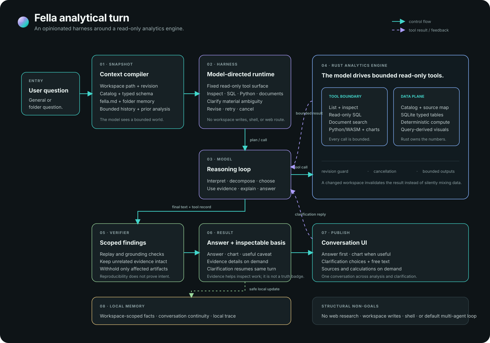

# Fella architecture

Fella is an Electron desktop app with a Svelte 5 renderer and a local Rust
analytics engine. The renderer owns presentation and interaction; Rust owns
source access, analysis execution, verification, and durable analytical
records.



## System at a glance

```text
Electron main process
  ├── native window, menus, OS integration
  ├── fella:// protocol
  └── allowlisted preload bridge
          │ JSON IPC
          ▼
Svelte 5 renderer ── user interaction and safe presentation
          │ line-delimited JSON over stdio
          ▼
Rust engine
  ├── model-directed analysis loop
  ├── workspace catalog and read-only tools
  ├── bounded SQL and sandboxed Python
  ├── verification and evidence
  └── conversations, Investigations, results, artifacts, reports
```

The renderer must not become an alternate analytics authority. IPC exposes
specific operations rather than arbitrary filesystem or process access.
Implementation entry points include `electron/main.mjs`,
`electron/preload.cjs`, `backend/src/stdio.rs`, and
`backend/src/engine/`.

## Analytical turn

A turn begins with the user's immediate request, the selected conversation
scope, relevant history, and bounded workspace context. The model can inspect
sources, choose useful analysis steps, execute allowed tools, interpret their
outputs, and request clarification when an unresolved choice could materially
change the result.

The Rust engine enforces the source boundary and tool contracts. It persists
the request, workspace revision, interpretation, tool trace, result, evidence,
verification findings, and rerun lineage. A successful query or check proves
only what that operation checked; it does not certify the business meaning.

The lifecycle is adaptive. A small question need not create a multi-step
Investigation. The user can explicitly create a named Investigation for longer
work, edit its Questions, and inspect its Brief, Sources, Analysis, and Results.

## Workspace data and execution

The mounted folder is the data-access boundary. The catalog assigns
workspace-relative source identities, applies `.fellaignore`, classifies
supported inputs, and records the workspace revision. A run is tied to the
revision and actual source scope it used; a later catalog refresh does not
rewrite the old run.

- SQLite is the default analytical database. CSV/TSV, JSON/NDJSON, and supported
  spreadsheet sheets become queryable tables.
- Text, Markdown, logs, and extractable-text PDFs are searchable documents.
  There is no OCR or general Office document viewer.
- DuckDB is an optional Cargo feature for custom builds, not an automatic
  fallback in standard releases.
- SQL is single-statement and read-only. Result bounds and truncation are
  explicit in the [analysis tool contracts](./ANALYSIS-TOOL-CONTRACTS.md).
- Python uses an embedded RustPython guest compiled to WebAssembly and run by
  Wasmi. The guest has no filesystem, network, environment, or subprocess
  access; a narrow bridge supplies bounded read-only SQL results.

## Generated answer presentations

The analytical answer and its presentation are separate records of
responsibility. The model can return a declarative **json-render** component
tree to arrange the supported answer as narrative, metrics, tables, charts,
and locally interactive controls. The shared catalog defines the available
component vocabulary; the Svelte renderer maps that vocabulary to Fella's
components.

The presentation is grounded in supplied saved results. It cannot read files,
run SQL or Python, invent replacement values, change evidence, or alter a
verification outcome. The Rust engine remains authoritative for analysis.
Invalid or unavailable presentation output must leave the supported answer and
recorded evidence accessible as a fallback.

Presentation and artifact validation lives in the Rust and Svelte paths under
`backend/src/engine/` and `src/lib/presentation/`. The focused presentation
checks are listed in [Testing](../testing/TESTING.md).

## Persistence and reports

A Conversation is an interaction thread; an Investigation is an explicitly
created, named record linked to its Conversation. They are not interchangeable.
Deleting a Conversation removes its transcript and linked Investigation.
Explicitly saved results, reports, supporting analysis records, and revisions
remain in the Workspace.

Saved outputs carry stable identity, source/run lineage, and presentation
revisions. Reopening or moving an output does not rerun its analysis. Reports
reference saved outputs and can be exported as Markdown; export uses persisted
values and discloses presentation details it cannot faithfully represent.
See the [product model](../product/PRODUCT-MODEL.md) for ownership and lifecycle.

## Network and trust boundaries

- Model requests go from the local Rust engine to the provider selected by the
  user. Prompts and relevant context or tool results can include workspace
  content; provider retention follows that provider's policy.
- No web search or page-fetch tool is shipped.
- Workspace source operations are read-only. There is no shell or terminal
  feature and no agent tool to modify source files.
- Provider credentials are held in `auth.json` in the application data
  directory, separate from settings and conversation transcripts.
- The Python guest cannot access the network. Packaged updates are user
  initiated.

See the repository [security policy](../../SECURITY.md), [Product](../product/PRODUCT.md),
and [Testing](../testing/TESTING.md) for user-facing guarantees and their
limits.
