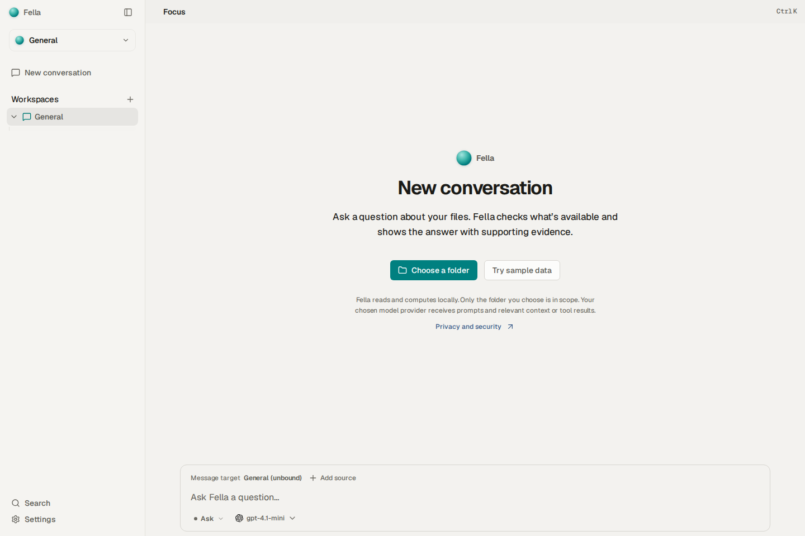
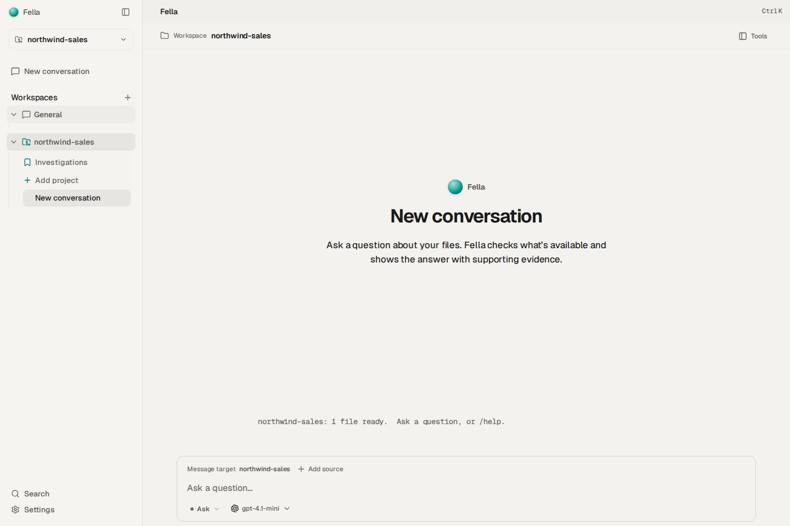
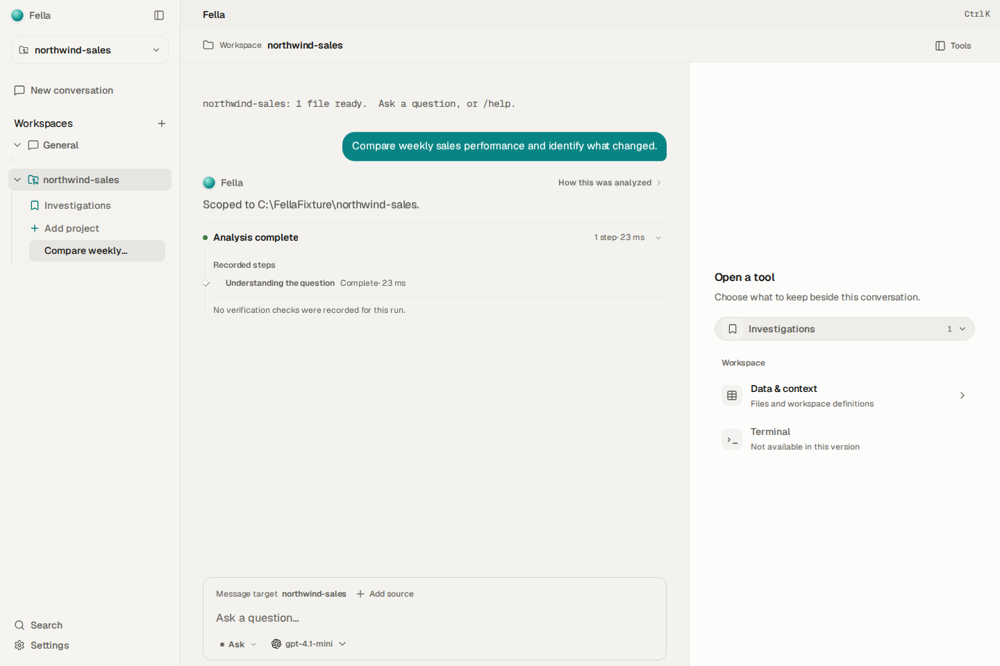
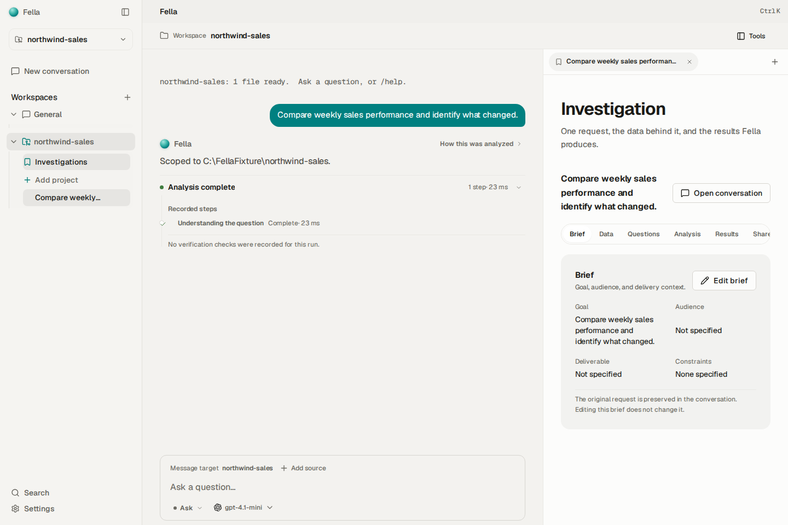
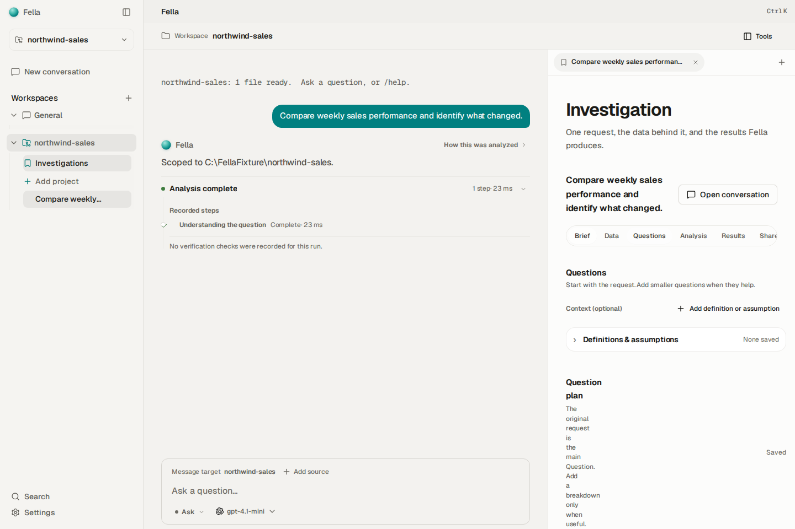
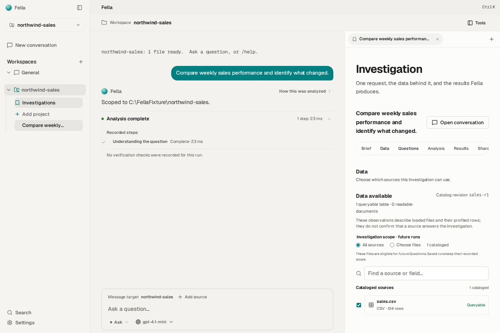
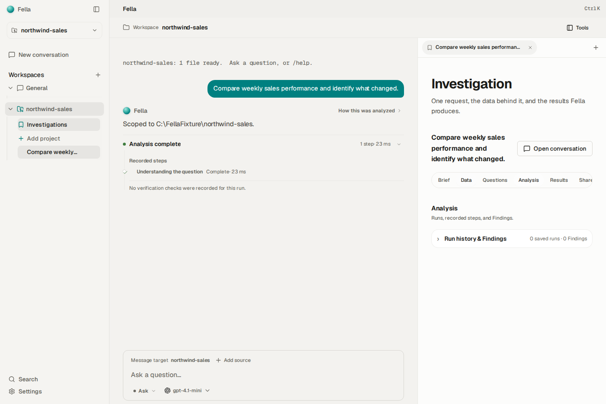
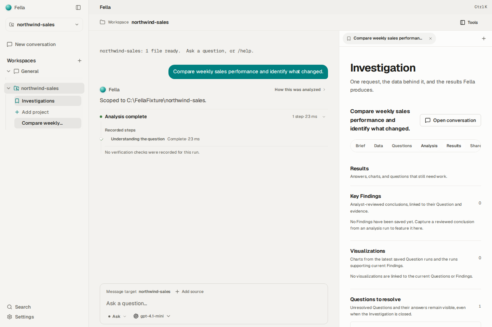
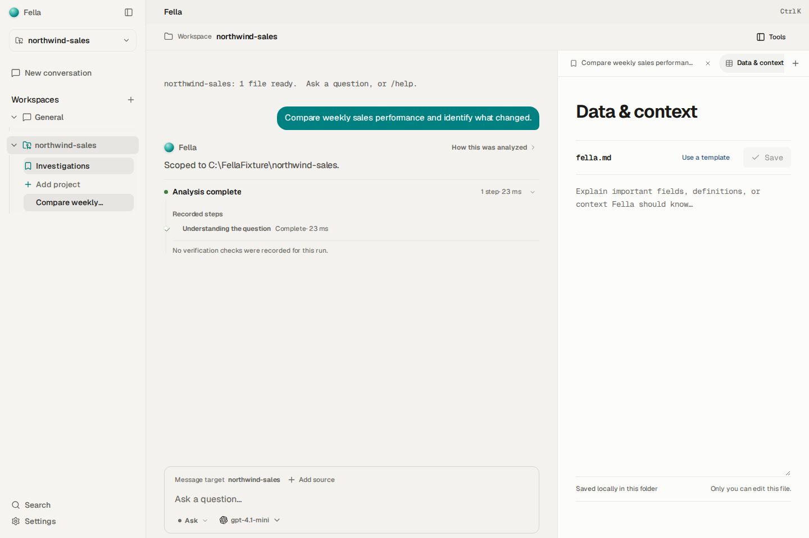
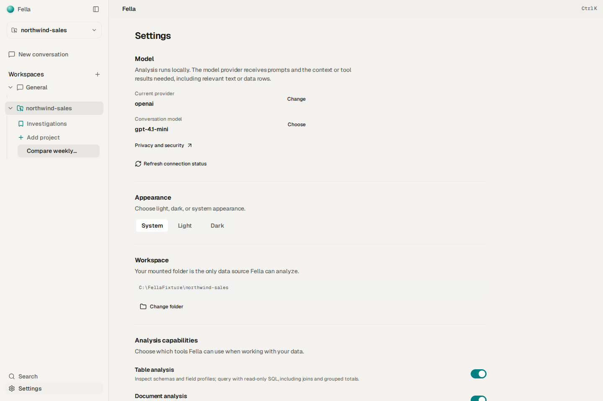

# Fella desktop: product and UX audit

**Audit date:** 14 October 2026 · **Scope:** Current desktop app, analyst workflow, visible product model, documentation alignment, and available UI test evidence. · **Code changes:** None. This report and the accompanying screenshots are the only deliverables from this audit.

## Executive assessment

Fella is no longer merely a chat window placed over an analytics engine. The current implementation has the outline of a coherent local-file analytics product: a Workspace defines the data boundary; an Investigation gives a bounded analytical effort a durable home; it owns a linked Conversation and ordered Questions; an Analysis turn records an execution; and evidence, verification, Findings, visualizations, and a report support review and reuse.

That is a meaningful product foundation. The strongest parts are the constrained, read-only local analytics runtime; the durable links between a Question and its run; clear source-scope and provenance concepts; the low-ceremony first-use path; and the newer shell model in which conversation remains primary and Tools are optional. The engine and domain model are more coherent than the interface and some of the older product documents imply.

The main weakness is legibility. A first-time user can start a conversation without learning the domain model, but the relationship between a freeform chat, a Question, an Analysis run, an answer, a Finding, and a shareable report is not yet consistently obvious. Some workflow state is split across the Conversation and the Investigation tool. Several older documents still describe the retired Focus / Investigation / Workbench top-level modes and multi-pane environments as if they were current. The most concrete visual defect found is in the Questions section: its heading and save controls collapse into an extremely narrow column at an ordinary desktop width. The right-hand Tools pane is also narrow enough that the six-section Investigation navigation feels crowded.

My overall read: **strong analytical runtime and increasingly coherent records; a promising but still uneven analyst-facing workflow; and a visible documentation/UX contract drift that makes the product feel less settled than its underlying model.** This is not a recommendation to rebuild the engine. The next work should make the existing model easier to understand and operate, fix the responsive layout defect, and bring the canonical docs into line with the app that now exists.

## Scope and evidence

This audit inspected the active Svelte/Electron shell and relevant components, the Investigation command path, the product and interaction documents, the current workspace E2E suite, and rendered screens at 1440 × 960. The images are browser-rendered captures of the desktop renderer in a deterministic UI fixture. They show real layout and interaction affordances, but fixture content and assistant answers are not live-model output. The images use the light theme and do not include the native Windows or macOS frame.

Validation performed:

- `pnpm check` completed with 0 errors and 0 warnings.
- The unchanged `pnpm test:e2e:workspace` run completed with **98 passed and 2 failed out of 100**. No tests were changed, skipped, or rerun to improve the score.
- Those E2E tests install a deterministic mock for the desktop bridge. They provide useful evidence about UI navigation, state persistence, accessibility hooks, and interaction wiring. They do **not** establish correctness of model-generated breakdowns, SQL, Python analysis, analytical answers, or behavior on arbitrary real-world folders.
- No live-model benchmark, real-file correctness benchmark, novice usability study, or analyst observation session was run as part of this audit. Those remain important evidence gaps.

This means no fresh model evaluation was launched for the original audit. Fella does have historical live-model diagnostics and a more ambitious evaluation framework in the repository; Part II below inspects those artifacts and distinguishes them from validated product-quality evidence.

The failures are reported in the test section below with their exact contract tension. They should remain visible until the expected product behavior is adjudicated; this report does not silently convert either failure into a pass.

## What the app is today

### The central product object

The closest current product description is in [PRODUCT-MODEL.md](../PRODUCT-MODEL.md): Fella is an AI analytics harness for analysts working with files, and an Investigation is the durable unit of work. This model separates several facts that are easy to conflate in a chat-first product:

- A **Workspace** is the explicit local data boundary, usually a mounted folder.
- A **Source** is a cataloged file, sheet, or supported document in that Workspace.
- An **Investigation** is a bounded effort to answer an analytical problem.
- Its **Brief** records goal, audience, desired output, and constraints.
- A **Question** is the root request or a smaller answerable piece of it.
- A linked **Conversation** is where the user directs, clarifies, and reviews the work.
- An **Analysis turn** is one bounded execution. It carries the run identity and context.
- **Evidence** and verification records substantiate or challenge an answer.
- A **Finding** is a durable, reviewable claim; a chart or report is a reusable output.

This is a cohesive model because the objects answer different analyst questions: What problem are we solving? What sources did we use? What did we ask? What ran? What supports the claim? What can be handed to somebody else? The model also preserves ownership: the transcript does not become the source of truth for run provenance, and changing a displayed layout should not change data access or analytical state.

The important qualifier is that the product-model document is explicitly a north star, not a declaration that all of these capabilities are fully implemented. The audit therefore distinguishes current UI and persistence from future product intent.

### Current shell and navigation

The active shell is simpler than the older UX architecture documents:

1. A global sidebar holds General, mounted workspaces, their conversations and Investigation entry points, plus Search and Settings.
2. The main content is a Conversation with its composer. The composer remains inside the conversation surface.
3. A workspace-level Tools pane can be shown or hidden. With no tool open, it offers Investigations, Data & context, and Terminal. Investigations are selected from a dropdown; opened tools become pane tabs.
4. An Investigation has its own internal sections: Brief, Data, Questions, Analysis, Results, and Share. Its Conversation is the Investigation’s linked Conversation, not an unrelated secondary chat.
5. Workspace-level Data & context is separate from the Investigation’s catalog/scope view. The former edits or displays workspace guide/context; the latter shows cataloged data and the Investigation’s source scope.

This is a better conceptual fit than a model where Focus, Investigation, and Workbench are presented as three peer destinations. It lets the user keep the conversation visible while opening a relevant tool, without making analysis screens look like independent applications. The current implementation also has request guards for quick tool-tab switches, and the suite includes coverage for Investigation/conversation identity and rapid tab navigation.

However, the shell still carries a few traces of the older model. In the clean first-launch screenshot the titlebar says “Focus,” even though the visible page is a new Conversation and the current app’s primary interaction is chat. That leftover vocabulary subtly tells the user there is a mode or view to understand before they have done anything.

### First use and everyday interaction

The first-launch screen is restrained and understandable: Fella identity, General workspace selection, New conversation, a choice to choose a folder or try sample data, a short privacy/provider disclosure, and a composer. It does not force a user to configure an Investigation before asking their first question. This supports the desired “easy to get into, hard to get good at” principle.

When a folder is selected, the conversation becomes scoped to it, and the UI surfaces the active scope. The user can continue to ask in chat and open an Investigation from the conversation or Tools pane. This is an appropriate progressive-disclosure strategy: the beginner can ask; the analyst can inspect sources, frame an Investigation, and work with persistent Questions and results.

The caveat is that first-use simplicity pushes some important distinctions into the next step. A user can ask an open-ended prompt and later discover that the durable Investigation has a Brief, Questions, an Analysis record, Findings, and Share. The UI should make it easier to answer “Did my prompt create an Investigation?”, “Is this chat attached to that Investigation?”, and “What does Analyze do that sending a chat message does not?”

### Investigation work surface

The Investigation is organized into six internally navigable sections rather than one long continuous page. This is directionally strong: it gives the work a readable sequence and keeps dense details out of the initial Brief. It is not a rigid wizard; the user can move among sections and the model can propose or adapt the question plan.

- **Brief:** goal, audience, deliverable, constraints, and a route to the linked Conversation.
- **Data:** catalog observations, source readiness, and source selection for future runs. The UI correctly warns that catalog observations do not themselves prove a source answers the Question.
- **Questions:** an editable parent Question and optional ordered child Questions; optional definitions and assumptions; suggested breakdown; automatic saving; coverage counts; and per-Question Analyze actions.
- **Analysis:** linked run history, run details, evidence, method, provenance, and Findings.
- **Results:** Findings and visualizations, question coverage, and links back to the analysis that produced them.
- **Share:** a report/export projection of saved work rather than a copy of the raw transcript.

This decomposition maps well to analyst work: frame, discover, decompose, execute, review, communicate. Its current friction is not that the app lacks analytical sections; it is that those sections and their relationships are packed into a narrow Tools pane and use several different kinds of status and artifact.

The Questions screen illustrates the issue most clearly. The intended capabilities are good, but the page puts optional semantic context, Definitions & assumptions, Question plan, autosave state, completion, breakdown suggestion, coverage summary, empty state, and add-question controls close together. It is a lot of concepts for the highest-cognitive-load part of the workflow. The navigation helps divide the overall Investigation, but the Questions section itself could still use clearer hierarchy and progressive disclosure.

### Analytics engine and trust boundary

The code and architecture docs describe a deliberately bounded runtime. The desktop renderer is sandboxed; local data is read through the Rust engine and an allowlisted bridge. The shipped engine uses bundled SQLite; supported tabular formats include CSV/TSV, JSON/NDJSON, and supported Excel inputs. Supported text and extractable-text PDF files are searched as documents; PDFs need a selectable text layer. No OCR or embedding index is provided in the default path. Parquet depends on a custom DuckDB build and is not part of the standard release.

For computation, the model can use read-only SQL, a bounded sandboxed Python route, document search/read, and structured chart production. The runtime enforces limits; the app does not give the model unrestricted shell or filesystem writes. Model calls go to the configured provider. This is a strong point of product coherence: the promise is not “an unconstrained agent that can do anything,” but “a model that can investigate local files through visible, bounded analytical tools.”

The interface exposes some of this well through source scope, run records, evidence, checks, and caveats. Still, there is a meaningful distinction between an answer that sounds right, an answer supported by the recorded evidence, a verification check that passed, and a Finding someone has reviewed. The implementation has vocabulary and records for these states, but the user should not need to infer those distinctions from status colors or investigate several screens to find them.

## Analyst-workflow audit

| Analyst step | What is already present | Strength | Gap / uncertainty |
|---|---|---|---|
| 1. Get the problem | Start with a natural-language prompt; an Investigation brief can capture goal, audience, deliverable, and constraints. | Very low entry cost. The user can begin in the Conversation rather than learning an analytics product first. | The brief is not yet the unavoidable or consistently visible framing step. A prompt can become durable analytical work without the audience, decision, or expected deliverable being made explicit. |
| 2. Learn what data is available | Workspace catalog, source profiles, readable/skipped source states, source selection, and Data/context surfaces. | Strong local-file boundary and evidence that data inspection precedes computation. The UI cautions that availability is not proof of answerability. | Workspace guide/context and Investigation data inventory have similar names but different jobs. The path from “I inspected these files” to “these are the sources this Question may use” needs to stay explicit. |
| 3. Decompose the question | Durable parent and linked child Questions; reorder/remove/edit; suggested breakdown; definitions and assumptions. | This is a genuinely analyst-shaped capability, not just one chat prompt. The plan can change as understanding improves. | The quality and depth of model suggestions are not established by the mocked E2E suite. Users need a visible signal that a proposed breakdown is a draft, and a clear way to judge whether it covers the original request. |
| 4. Answer smaller questions | Each active Question has a dedicated Analyze action and can be linked to an individual run. | Atomicity is good: the analyst can inspect a discrete question and its provenance rather than relying on one giant answer. | The boundary between structured Question analysis and ordinary follow-up chat is ambiguous. One E2E failure directly exposes this (see below). The UI needs to make clear whether a freeform follow-up belongs to a Question or is unlinked conversation. |
| 5. Build the query/method | The model chooses among bounded SQL, Python, document, and chart routes; recorded plans and evidence can show method. | The user does not need to author SQL to get started; the method is inspectable after a run. | There is not a clear analyst-operable query notebook or scratchpad where a user can revise the query itself and rerun it. Steering largely happens through the natural-language Question and follow-up. This may be intentional, but it is a product choice worth making explicit. |
| 6. Run the analysis | Persisted Analysis turns, current source scope and context snapshots, run history, stop/retry behavior, and run linkage. | Good continuity and traceability. A run is more than an ephemeral assistant response. | End-to-end engine correctness on realistic, messy folders is not evidenced by this UI audit; the mocked tests do not invoke the real model/engine path. |
| 7. QA the answer | Verification results, evidence inspection, coverage states, outdated-result detection, run context, caveats, and explicit gap handling. | This is a major differentiator from “chat with a chart.” The app has a meaningful place to challenge or qualify an answer. | A passing deterministic check is not the same as a correct business interpretation. The UI must say what was checked and what remains a judgment. “Partial answer” can read as a system failure unless its scope and next action are immediately clear. |
| 8. Visualize | Structured chart evidence and interactive visualization displays; charts can be reviewed and exported. | The visualization belongs to the analysis and can retain its run/evidence lineage. | A generated chart is not automatically a reviewed Finding. That distinction is conceptually correct, but the handoff from a chart/answer to a durable reusable output may feel like extra curation unless the reason is clear. |
| 9. Hand it over | Findings can be captured/revised with evidence links, caveats, assumptions, and revision history; Share can produce a report; Projects can curate references. | There is a path from analysis to a durable deliverable and provenance is not discarded. | The path is comparatively manual. The user must understand what is a transcript answer versus a Finding versus a report. External handoff and recipient-oriented review are limited to the current export/projection path; no live team collaboration or external PM workflow was validated. |
| Keep work alive for a week or month | Investigation and run history are durable; edits can make prior answers outdated; linked Conversation preserves direction and clarification. | Strong foundation for long-running analysis rather than a one-shot chat. | The audit found no explicit timeline, due-date, reminder, or “what changed since last visit” concept in the primary Investigation flow. Do not add these by default without validating demand, but continuity summaries are a likely future opportunity. |

## Strengths worth preserving

### 1. The model is becoming coherent around analyst work

Workspace, Source, Investigation, Question, Conversation, Analysis turn, Evidence, Finding, and Artifact are not arbitrary UI labels. Their ownership boundaries address real analyst needs and reduce the tendency to put every fact into a transcript. This should remain the conceptual backbone.

### 2. The engine is purposefully constrained

Read-only source access, bounded execution, explicit workspace scope, and provenance are strong product decisions. They help make local-file analysis safer and more explainable. There is no reason from this audit to disturb the analytics engine’s core execution loop.

### 3. The app preserves an approachable starting point

New Conversation, choose a folder, sample data, and an always-visible composer give a new user a clear first action. The advanced Investigation model can be discovered progressively instead of becoming a mandatory setup wizard.

### 4. Conversation and Investigation identity are explicitly connected

The Investigation owns one canonical Conversation in the current workspace model. Opening it should not create a second transcript or make chat identity ambiguous. Tests that exercise opening an Investigation’s linked Conversation and fast tab changes passed in the full suite.

### 5. Scope and provenance are treated as first-class concerns

Source scope, run snapshots, citations/evidence, stale results, checks, caveats, and revision history are represented in the domain and UI. This directly supports trust and later handoff.

### 6. Visual language is restrained at the shell level

The captures show a calm neutral palette, restrained borders, pill navigation, curved controls, and useful whitespace in the conversation area. It avoids the dense tile-grid/dashboard look. The overall shell has a recognizable Fella mark and consistent component vocabulary. The main visual problems are local hierarchy and responsive behavior, not an absence of design taste everywhere.

## Gaps and risks, ordered by impact

### P1 — Questions heading breaks down in the normal split layout

At 1440 × 960, with the Tools pane open, the Questions section’s “Question plan” heading and its explanatory copy render in a very narrow column and wrap awkwardly. The Save state is displaced to the far right; the surrounding tabs also feel tight. This is a visible usability and polish defect, not merely a hypothetical responsive edge case.

The main workspace split allocates 62% to the Conversation and 38% to Tools, with minimums of 320px and 280px, and only stacks the panels below a workspace-area width of 1000px. The Investigation component then has a container rule for panes under 900px that turns the Question heading into a column. The rendered result suggests the heading’s content/flex sizing is not expanding to the available line width under that layout. The screenshot establishes the visual behavior; the CSS is a plausible implementation lead, not proof of a single root cause.

Evidence: [05 — Investigation Questions](assets/05-investigation-questions.png), [workspace split CSS](../../src/routes/+page.svelte#L501), [Question responsive rule](../../src/lib/components/InvestigationBriefView.svelte#L3249).

### P1 — Chat, Question, run, answer, and Finding need a clearer relationship

The durable model is good, but the user-facing mental model is not fully self-explanatory. The app supports ordinary Conversation prompts and explicit per-Question Analyze actions. A user needs to know whether a follow-up is simply chat, is implicitly attached to the selected Question, or creates a new Question/run. If the answer is not obvious, transcript content and structured analysis can drift apart even when their records are individually sound.

This is not a call to put a whole Question plan into every chat prompt. The product model should preserve the user's original wording and the atomicity of individual Questions. It is a call to expose the relationship and linkage clearly, including when an ordinary follow-up is intentionally not linked to a Question.

### P1 — Canonical docs describe different products

The current product model calls itself canonical and describes the durable Investigation. In contrast, [INTERACTION-MODEL.md](../INTERACTION-MODEL.md) still declares Focus / Investigation / Workbench as three primary views and describes environments and pane arrangements. [COMPOSABLE-INTERFACE.md](../COMPOSABLE-INTERFACE.md) still says it is the contract for an environment-tab redesign and models up to four workspace panes. The active app instead keeps a Conversation primary, offers a Tools pane, and opens tool tabs within that pane. Some older product-vision text still describes Investigation/Question/Definition/Finding objects as missing or future work.

That contradiction costs more than documentation neatness: it makes product decisions harder to discuss, risks reintroducing retired interaction patterns, and makes it unclear which feature promises have shipped. The docs should label historical plans as superseded or update the active contracts.

### P2 — “Focus” is legacy vocabulary in the visible shell

The clean first-launch screen is a new Conversation, while the titlebar displays “Focus.” “Focus” was previously a view/mode; in the current model the user’s stable object is the Conversation in a Workspace. Retaining this label adds an unnecessary concept and weakens the simple first impression.

### P2 — Investigation navigation is dense for a narrow pane

Six sections—Brief, Data, Questions, Analysis, Results, Share—are a useful separation of content, but they compete for horizontal room inside the right pane. The Questions screenshot shows the tabs compressed and Share partly at the edge. The layout should communicate that these are the Investigation’s own sections without making the right pane feel like a miniature full-width application.

### P2 — “Data” and “Data & context” sound like the same destination

Within an Investigation, Data means cataloged sources and this Investigation’s scope. At Workspace level, Data & context means workspace context/guide content and broader source context. Their scopes differ, but the naming is close enough to cause confusion. The UI should name their job and ownership distinctly, not merely their data theme.

### P2 — Partial coverage needs to remain informational, not punitive

The app has status descriptions and next-step guidance in a shared status helper; for example, incomplete coverage means the answer covers only part of the requested scope and suggests adding data, narrowing the Question, or documenting the limitation. That is the right semantic direction. But the visible label “Partial answer” can still look like a failed run or a guaranteed defect, especially when repeated in Results, Findings, or curated Project references. Status, reason, and available action should appear together and proportionately. A documented and accepted gap must remain distinguishable from an execution failure.

### P2 — Disabled Terminal is visible product chrome without a present capability

The Tools chooser shows Terminal with “Not available in this version.” That is honest, but the control still asks the user to process an unavailable feature. It also risks implying that shell access is part of the product’s core workflow even though the runtime’s safety boundary intentionally does not give the model unrestricted shell access. The long-term meaning of “Terminal” should be decided before it becomes a persistent tool category.

### P3 — No clear “return to my work” summary for long-running analyses

Persistence and run history exist, but the primary flow does not foreground a compact return summary such as the current question, what has changed, which questions remain unresolved, and what needs the analyst. This could matter for work lasting a week or a month. Validate with actual users before treating it as a required feature.

### P3 — Layout behavior outside the captured desktop state is not fully audited

This visual pass covered one desktop viewport and light theme. It did not systematically assess the full width range, Windows/macOS native titlebar interaction, keyboard-only flow, dark theme, zoom/scaling, or screen-reader experience. The E2E suite covers many accessible labels and interactions, but that is not a substitute for visual/device testing.

## Test evidence and unresolved failures

The current workspace suite completed **98/100**. The other 98 tests passed, including a broad set of interaction journeys for workspace selection, Investigation tabs, linked conversations, rapid tab switching, autosave, Question lifecycle, run history, evidence, Findings, report export, source search, Settings, and Project editing. That is meaningful regression evidence for the deterministic interface contract.

### Failure 1: follow-up chat is expected to carry Question-plan context

Test: “an analyst can edit the main Question and linked subquestions without rewriting the request.”

The test saves a parent Question, “Measure conversion by channel,” and child Questions including “Compare conversion by region” and “Compare conversion by device.” It then sends the ordinary chat message “Which device has the strongest change?” The test expects the resulting request sent to the mock bridge to include the selected child Question and parent-plan context while keeping that context out of the visible user transcript. The observed bridge request contained the ordinary submitted message instead, so those assertions failed.

The explicit Analyze action has a different, intentionally structured path: it loads the saved Question, sends that Question’s text, and carries the Investigation and Question IDs into the run. Ordinary chat uses the ordinary ask path. The failure therefore exposes a real unresolved product contract: should a freeform follow-up automatically bind to the currently selected Question, or should it remain unlinked unless the user explicitly invokes Analyze? The latter is consistent with the principle of preserving the user's actual message and analyzing Questions individually; the former is what this test currently asserts. Do not resolve this by silently appending a plan to chat or by weakening the test. Adjudicate the intended interaction, then update behavior or test contract with an explicit rationale.

Evidence: [test](../../tests/e2e/workspace.spec.mjs#L2211), [explicit Question-run path](../../src/lib/commands.ts#L1101).

### Failure 2: Project curation expects an internal status enum

Test: “Projects curate Findings, visualizations, definitions, and open Questions by canonical reference.”

The fixture Question’s internal answer state is `incomplete`, with the reason “Regional detail is not available.” The test expects the curated UI string to contain “Explain weekly sales · incomplete.” The UI uses the shared user-facing status mapping and renders “Explain weekly sales · Partial answer,” so the exact text assertion fails.

This appears to be a vocabulary/contract mismatch rather than evidence that the canonical Question reference was lost: the app deliberately maps an internal state to a human-readable label. Yet “Partial answer” is a sensitive label in this product because it can be mistaken for a broken result. The correct resolution is a product-language decision: preserve an internal enum in a diagnostic surface, use the human-readable status with its reason, or choose a more neutral visible label. The failure remains a failure in this run; it should not be regraded as passed on the basis of this interpretation.

Evidence: [test](../../tests/e2e/workspace.spec.mjs#L5383), [failing label assertion](../../tests/e2e/workspace.spec.mjs#L5465), [shared status labels](../../src/lib/investigation-question-status.ts#L1), [curation mapping](../../src/lib/components/ProjectCuration.svelte#L153).

### What the test run does not prove

Because the suite uses a deterministic bridge mock, a passed “analysis” journey usually proves that the UI submitted the expected data and rendered a fixture result. It does not prove that the model will propose a good breakdown, that the generated SQL answers the Question, that a chart has the right grain, or that source profiling handles every messy file. Real-model and real-folder quality should be measured separately, with fixed benchmark questions and implementation-independent acceptance criteria.

## Visual evidence

All captures below are from the same 1440 × 960 light-theme deterministic UI session. Text/data in the mock is illustrative; the visible layout and controls are from the app renderer.

### 1. First launch: a strong low-friction start

The initial action is clear and the privacy/provider disclosure is quiet. The titlebar’s “Focus” label is the visible inconsistency.

### 2. Folder-scoped conversation

The workspace is visible in the sidebar and top context; the composer remains the main interaction. The user can begin in plain language without opening a tool first.

### 3. Tools chooser

The optional Tools surface is a distinct place for workspace-level tools. The Investigation selector is a dropdown, Data & context opens as a tab, and Terminal is present but disabled.

### 4. Investigation Brief

The Investigation has an internal navigation and exposes its goal, audience, deliverable, and constraints. This is a useful durable frame for the analysis.

### 5. Questions: the clearest visual defect

The Question-plan heading and explanatory copy collapse into a narrow column. The tab row is also tight. This is the strongest direct visual finding in the audit.

### 6. Investigation data and scope

The source inventory and scope controls are visible, with a warning that catalog observations do not establish that a source answers the Investigation.

### 7. Analysis history

The Analysis section has an explicit home for run history and saved Findings, even when empty.

### 8. Results and unresolved work

The Results section separates Findings, visualizations, and Questions needing resolution. The empty state also reveals how much of the product’s usefulness depends on actually completing the linked analysis lifecycle.

### 9. Workspace Data & context

This is a workspace guide/context surface, not the same screen as the Investigation’s source inventory. The difference in ownership is useful; the similar naming is not.

### 10. Settings and analysis capabilities

Analysis capability controls are present in Settings. This supports discoverability and user control, though the full settings view requires scrolling.

## Recommended order for follow-up work

This audit does not implement these changes. Based on user impact and dependency, a sensible order for future decisions is:

1. **Fix the Questions pane layout and validate width breakpoints.** It is a direct, reproducible visual failure in the ordinary split view.
2. **Decide the chat-to-Question contract.** Specifically, distinguish ordinary follow-up from “Analyze this Question,” and define whether either action links a run to a Question. Resolve the existing failing test only after that decision.
3. **Make the object relationship legible in the UI.** Explain how a prompt becomes or relates to an Investigation; show the active Conversation/Investigation relationship; show where an answer lives and what becomes a reviewed Finding.
4. **Reduce vocabulary collisions and legacy residue.** Revisit “Focus,” “Data” vs “Data & context,” and the visible disabled Terminal option.
5. **Align current docs with the shipped navigation and object model.** Mark superseded multi-pane/environment documents as historical or replace their status and diagrams. Keep canonical product intent distinct from shipped capability.
6. **Run a real-data and analyst-quality evaluation.** Use a fixed, messy-folder benchmark with expected evidence and metric grain, run it against the real engine/model path, and add an analyst review of whether the generated work is understandable and handoff-ready.
7. **Evaluate long-duration work with analysts.** Only then decide whether return summaries, timeline, reminders, or recurring analysis belong in the product.

## Bottom line

Fella has the beginnings of a distinctive product: **a local-file analytics harness that turns an open-ended request into a durable, scoped Investigation, while preserving a conversation for direction and a traceable record for evidence and handoff.** The engine’s bounded execution and the domain model support that story.

The app does not yet communicate that story with the same consistency. The visible experience still carries some old navigation language; the Investigation/Conversation/Question relationships require inference; one key Question layout is visibly broken; and canonical UX documents disagree with the current shell. The highest-value path is refinement and alignment around the model already built—not expanding the feature list or replacing the analytics engine.

## Part II — Can Fella prove it is useful?

**Research date:** 14 October 2026. This is a focused review of Fella’s local evaluation and performance artifacts plus public primary-source material from adjacent data-agent and agent-harness projects. It is not a hands-on comparative trial of those products. Vendor descriptions below are useful evidence of design and evaluation practice, not independent validation of vendor performance.

### Short answer

Fella can eventually make a strong, measurable claim, but the current repository does **not** yet prove analytical superiority, lower cost, or greater usability. It contains the right beginnings of an evaluation system—task contracts, episode traces, a same-model harness ablation, pinned run metadata, a paired scorecard, and a human-review rubric—but the actual filesystem-analysis corpus is still too small and narrow to support a market-level claim.

The best initial claim to pursue is not “most intelligent analyst” or “cheapest tokens.” It is:

> **For questions over unfamiliar, messy local folders, Fella more often produces a correct, evidence-backed result that an analyst can hand off without repair—within a declared time and inference budget.**

That is both closer to the product’s distinctive job and harder to game than a raw answer-accuracy, token, or latency number. It is a hypothesis to test, not a claim Fella can make today.

No single scalar proves usability. A headline rate can summarize the user-valued outcome, but its numerator, denominator, confidence interval, false-deferral rate, unsupported-claim rate, and cost/latency distributions must remain visible beside it.

### What adjacent products and research suggest

| Reference | What it is trying to make cohesive | Transferable lesson for Fella | What it does *not* prove about Fella |
|---|---|---|---|
| [OpenAI’s in-house data agent](https://openai.com/index/inside-our-in-house-data-agent/) | A natural-language data teammate grounded in organization-specific definitions, code, annotations, memory, and live warehouse context. It can inspect a result, detect a suspicious intermediate outcome, revise its approach, and carry context across turns. Its published evaluation compares query results to manually authored gold SQL and exposes assumptions, execution steps, and underlying results. | Treat *context about what the data means* as part of the product, not just a prompt. Evaluate resulting tables and claims, not SQL string similarity. Keep the agent free to choose a method; OpenAI reports that overlapping tools and overly prescriptive paths hurt its own agent. | It is an internal warehouse agent with curated metadata and institutional systems. Its reported adoption and time savings are not a controlled comparison with a local-file desktop app. |
| [Hex Notebook Agent and Threads](https://learn.hex.tech/docs/getting-started/ai-overview) | Hex separates an editable, technical notebook agent from conversational Threads intended for non-technical users over curated, semantically modeled data. In the notebook, generated cells can be inspected and accepted or undone at cell level. | Different expertise levels need different *presentation and control surfaces* over the same analytical foundations. Fella’s ordered Investigation can expose what happened and what resulted without forcing the user to author SQL/Python or follow a fixed model script. Review should attach to concrete outputs/evidence, not become a vague global warning. | Hex’s primary data source is a connected warehouse/semantic layer. It does not establish that Fella’s current whole-folder discovery, file normalization, or generated analysis works well. |
| [Anthropic Managed Agents](https://www.anthropic.com/engineering/managed-agents) | Long-running work is decomposed into durable session history, a replaceable model/tool orchestration harness, and an execution sandbox with explicit interfaces. The article also warns that harness accommodations can become obsolete as models improve. | Keep conversation/session history, analytical orchestration, and local execution boundaries independently understandable and testable. Benchmark changes by model *and* harness version; do not assume more orchestration is always better. Fella’s durable Investigation/Question/Analysis records are a promising product-level counterpart to this separation. | It is an agent-platform architecture, not an analyst-quality benchmark. Its latency figures and operational results are Anthropic’s own workload and must not be compared to Fella’s ingestion numbers. |
| [UC Berkeley EPIC / DAB data-agent benchmark, v3](https://arxiv.org/abs/2603.20576v3) | End-to-end data work involving fragmented enterprise databases, inconsistent/ill-formatted joins, unstructured text, and domain context. Its October 7, 2026 version describes 104 queries across 17 datasets and four DBMSs; the best reported state-of-the-art agent reaches 57% pass@1. | Data-agent evaluation needs realistic, multi-source episodes and independent outcome checks. Even strong systems have substantial headroom on tasks that look like real analyst work, so “the model got a number” is not enough. | DAB is primarily multi-database enterprise data work. Its task set, environment, baselines, and scoring are not equivalent to a local folder, desktop workflow, or FQA-Bench score. The 57% figure is context, not a direct Fella target. |
| [CursorBench methodology](https://cursor.com/blog/cursorbench) | A domain-specific agent benchmark that plots correctness against token use and supplements offline tasks with controlled live-traffic evaluation, because a grader can accept output that still feels worse in actual use. | Pair reproducible offline measurement with real user-workflow evidence. Show quality-versus-cost tradeoffs rather than reporting “fewer tokens” as an independent win. Refresh task sets carefully and compare within the same benchmark version. | It measures software-development agents, not analysis. Its scores cannot rank Fella. |

Across these examples, the common pattern is not “put chat beside a tool.” It is a controlled loop: **understand the data and its meaning → choose work appropriate to the request → execute → inspect outcomes → recover or clarify → preserve evidence and state → make the result usable.** Fella’s product primitives already describe much of this loop. The gap is proving that the loop works on representative folders and that its visible records help people finish and hand off the work.

OpenAI’s published evaluation guidance reinforces the method: use objective task-specific checks where possible, human evaluation for qualities that are hard to reduce to a number, calibrate any model grader against human labels, and test edge cases that are costly to mishandle. Anthropic’s agent-evaluation guidance similarly treats an episode’s trace and final environment outcome as separate evidence, and recommends repeated trials because agent outputs vary. ([OpenAI evaluation best practices](https://developers.openai.com/api/docs/guides/evaluation-best-practices), [Anthropic: Demystifying evals for AI agents](https://www.anthropic.com/engineering/demystifying-evals-for-ai-agents))

### Fella’s evidence today: foundation versus proof

| Evidence area | What exists in the repository | What it currently supports | Limitation / interpretation |
|---|---|---|---|
| Product model and runtime | Durable Workspace, Source, Investigation, Question, Conversation, Analysis, Evidence, Finding, and output records; bounded read-only SQL/Python/document tools; scoped source snapshots and traces. | A coherent, inspectable product and a plausible local-file analyst workflow. | Object existence and tool guardrails are not evidence that an analysis is correct, complete, or understandable to a user. |
| Model-run observability | Persisted traces can include model/tool calls, elapsed time, first-token time in the eval runner, provider-reported prompt/output tokens, and operational friction signals. The UI can show model, calls, duration, and known token counts. | Enough signal to study orchestration, retries, tokens, and latency on runs where the provider reports usage. | Usage can be absent. Token counts are not a complete bill; provider caching, discounts, credits, local compute, folder preparation, and the user’s own review time are distinct costs. The product UI is observability, not an evaluation result. |
| Evaluation protocol | [FQA-Bench](../../bench/fqa-bench/methodology.md) defines whole episodes, intent-based answer contracts, repeated trials, workspace-disjoint splits, evidence/clarification/chart review, and no post-hoc gold changes. [Product-eval manifests](../../bench/product-eval/run-manifest.schema.json) can pin benchmark/task/workspace hashes, commit, provider/model/settings, budget, runner, result digest, repetitions, and pricing snapshot. | The evaluation *design* is unusually thoughtful and suited to testing a model-plus-harness rather than one prompt. | The protocol is not the corpus. The benchmark is explicitly an unreleased target-state specification; target counts must not be presented as completed evaluation coverage. |
| Current filesystem task coverage | 13 episodes on one clean UCI Bike Sharing workspace plus one controlled housing clarification/resume episode: **14 authored episodes across two workspaces**. A legacy generated FolderQA profile has 79 tasks, but shares one synthetic persona and mostly stages case-selected files. | Several concrete smoke tests for descriptive calculations, comparisons, one chart family, data limits, a forecast/scenario, and one typed clarification path. | Not a representative sample of analyst work; no broad whole-folder discovery or multi-domain blind-holdout evidence. The 79-task legacy set is not 79 independent workspaces. |
| Corpus target | The draft coverage plan calls for 12 workspace families, 180 independently reviewed episodes, 60 blind episodes, at least four independent workspaces for each claimed family, and workspace/source/generator-disjoint splits. | A useful destination for a defensible claim. | These are **targets**, not current assets. Current fixture coverage is explicitly marked partial or sparse for discovery, normalization, joins, statistics, data quality, evidence/communication, and most chart types. |
| Historical live-model analytics | The October 1 synthetic filesystem smoke scored **2/3** cases (single-table sum and average passed; a two-file comparison did not execute) at one iteration. Two simple chart fixtures scored **2/2**. | The current path has demonstrated that it can perform a couple of bounded calculations and basic charts on small controlled files. It also has a concrete cross-file failure to learn from. | Tiny, selected, one-shot smoke results. They are not a blind comparison, repeatability estimate, broad correctness rate, or release-grade benchmark. See the [recorded baseline](../../bench/product-eval/baselines/2026-10-01.md). |
| Historical continuity and cost | A 2026-10-06, one-episode synthetic continuity run passed its final answer screen; across three turns it used 6 model calls, 4 tool operations, 16.8 seconds summed turn latency, and 41,934 input + 481 output tokens. Workspace turns still ended `NeedsReview` despite the listed numeric checks passing. | Trace capture is useful for uncovering a mismatch between answer, verification state, and resource use. This is precisely why a single final-answer grader is insufficient. | One synthetic trajectory; not a latency or token baseline. “NeedsReview” was not adjudicated as either a correct caution or a false positive in that record. See the [continuity report](../../bench/product-eval/reports/backlog-7-continuity-2026-10-06.md). |
| Visualization journeys | On 2026-10-07 the recorded chart journey completed 6/6 Luna turns and 5/6 Gemma turns; an earlier run had 4/6 and 6/6. | The chart UI and orchestration can be exercised with live models and multiple chart requests. | This journey graded rendering/non-stalling, not numeric correctness, chart suitability, or analyst trust. The scores are diagnostic only; see [testing status](../TESTING.md). |
| Ingestion performance | Linux release-mode diagnostics report 5,000 small table sources published in about 3 seconds; a separate 10-GiB CSV (~275 million rows) in a mixed folder took about 578 seconds and used about 11.1 GiB SQLite scratch, with ~49 MiB reported process peak RSS. | There may be a strong fast path for many small sources; a specific very-large-file workload has been exercised. | Single-machine, non-controlled diagnostics—not a comparative result, packaged Windows result, analyst-task runtime, or guarantee. The large-file publication time and scratch footprint are clear optimization questions. See [performance measurements](../PERFORMANCE.md). |
| Human usability | UI E2E journeys, screenshots, and a review annotation schema exist. | UI navigation and visible state can be tested; the report identifies specific information-architecture and layout issues. | No observed novice or analyst sessions, no time-to-completion study, no inter-reviewer agreement results for the blind task set, and no measured analyst correction/rework rate. |

The status is therefore: **good instrumentation and an evaluation plan; early evidence of individual capabilities; no validated headline performance claim yet.** The app’s strengths are most visible in scope/provenance, bounded local execution, durable work objects, and the ability to inspect a run. Its biggest evaluation risk is conflating “the tool ran,” “the output matched a small gold,” “the runtime marked it Verified,” and “a person can trust and hand off the analysis.” They are different outcomes and should stay separately measured.

### The metric I recommend

Use one primary, human-meaningful headline, with quality and efficiency guardrails beside it:

#### Blind handoff-ready success rate under a fixed budget

For **answerable blind analysis episodes**, count a success only when all predeclared conditions hold:

1. **Correct result:** the answer satisfies the task’s frozen analytical contract—measure, population/filters, period, grouping/grain, units, denominator where relevant, and numerical tolerance. A task need not use a particular SQL/Python expression or tool sequence.
2. **Grounded result:** material claims are supported by the declared files and trace/evidence; source, scope, and transformations agree with the result. No unsupported material assertion is left in the handoff.
3. **Usable handoff:** blinded analyst reviewers judge that the result is clear and complete enough to pass to its intended recipient without correcting the analysis. They may require stated assumptions, limitations, and a suitable chart/output only where the task contract says they matter.
4. **Budget compliance:** completion falls within a pre-registered ceiling for elapsed time, model calls, tool calls, and inference spend. Set these ceilings before a candidate run, based on the intended use case—not after seeing the result.

Report the rate as **passed episodes / valid answerable episodes**, with the task count, repeat protocol, 95% paired uncertainty interval for comparisons, and per-family breakdown. Invalid fixture/provider/evaluator runs must be shown separately rather than silently turned into model failures or successes.

Keep **unanswerable / insufficient-evidence episodes in a separate gap-handling rate**. A success there means Fella identifies the actual missing evidence, preserves any useful supported partial result, avoids inventing an answer, and gives a concrete next step. Mixing this with answerable tasks can make blanket refusal appear safe or make a correct limitation look like failure.

Always publish these guardrails beside the headline:

- **Unsupported material claim rate** and evidence/provenance support.
- **False deferral rate** on answerable tasks and missed-clarification rate on materially ambiguous tasks.
- **Correctness by capability family**, with task count and denominator; do not let easy sums hide failed joins, source discovery, or normalization.
- **Human repair rate**, reviewer disagreement, and median/p90 analyst time to accepted handoff in an observed-use study.
- **Cost per accepted result**, along with the success-rate numerator and denominator. Include failed-but-valid attempts’ cost; do not make cost look good by counting only successful low-cost runs.
- **Tokens, model/tool calls, median/p90 latency, retries, and local resource use** as diagnostic dimensions. Separate provider inference spend from local folder preparation/query/CPU/RAM/scratch and from user review time.

This rate answers “Can Fella reliably finish this class of analyst work?” Cost per accepted result answers “How economically?” Time-to-accepted-handoff answers “Does it make the analyst meaningfully faster?” None substitutes for the other two. A low token count with a wrong answer is not efficient; a correct but ungrounded answer is not a handoff; and a benchmark pass without a usability study does not prove the interface is usable.

### How to make the result defensible

1. **Freeze the product claim and task contract before candidate outputs are seen.** Start with one narrow claim, such as analysis of common tabular/document files in a mounted local folder. Do not claim generic “data analytics” coverage while forecast quality, statistical analysis, and broad source discovery remain sparse.
2. **Promote the benchmark from target to corpus.** Build and independently review the planned 180 episodes across the stated workspace families; reserve the 60-episode blind holdout with disjoint workspaces, source sets, and generator families. Include entire-folder discovery with nested directories and distractors—not just a named input file—and include messy schemas, duplicate/current-versus-archived files, mixed grains, joins, missingness, date/unit normalization, evidence gaps, and multi-turn follow-up.
3. **Use multiple graders for different facts.** Machine-check numerical/table/chart payloads against independently derived golds where possible. Have blinded reviewers grade semantic interpretation, evidence support, usefulness, and handoff quality. Calibrate any model grader against two independent human reviews and report disagreements. Never infer “the user asked for SUM” from surface wording or treat an internal verification label as the gold answer.
4. **Run paired, repeated conditions.** First compare Fella’s full harness to the same model in a model-only/file-context condition on tasks where the comparison is fair; this tests whether Fella’s context, tools, and orchestration add value. Keep model version/settings, data, prompts/task contract, and budgets pinned; change only the harness condition. Use at least three repeats per stochastic episode as the existing release protocol specifies. A second comparison against an analyst’s current workflow is needed to show product value, not merely harness lift. Cross-product comparisons should be secondary unless the same tasks, data access, and budgets can be made genuinely comparable.
5. **Measure the actual workflow, not just the answer string.** For a blinded analyst study, record time from task start to accepted handoff, whether the analyst completes the task, edits/corrections required, evidence opened, clarification exchanges, and confidence calibrated against correctness. Include novice/non-analyst participants separately if Fella intends to serve them; do not average their different jobs into a single undifferentiated score.
6. **Publish a quality–cost frontier.** For each condition, plot blind handoff-ready success against estimated provider USD per valid episode, and report tokens, latency, model/tool rounds, and local resource costs separately. Use a dated price snapshot and mark estimates as estimates; do not imply they equal a user’s invoice. A model/harness is more efficient only if correctness/helpfulness remain non-inferior under the pre-registered rule.
7. **Keep the test set and result auditable.** Publish benchmark version, hashes, commit, model/provider/version/settings, budgets, repetitions, grader version, blind-set custodian/reviewer protocol, exclusions, and all failures. Keep answer keys and private workspace material out of model-visible paths and public artifacts.

The repository already has substantial pieces of this protocol: whole-episode task records, paired manifests, task/workspace fingerprinting, a scorer that rejects mismatched runs, blind reviewer schemas, and a pre-registered release-decision document. The immediate work is to fill and independently review the corpus, run the protocol, and close its gaps—not invent a new score after seeing a favorable result.

### What Fella should try to be unusually good at

Raw arithmetic and simple SQL are likely table stakes when a strong model has a clean table and clear question. Fella’s more promising wedge is **turning an unfamiliar folder into a traceable, reviewable analytical answer**. That combines local source discovery, field/meaning interpretation, reading supporting documents, recognizing grain and data quality, joining only when justified, checking the result, and keeping the evidence attached to a durable Investigation.

The benchmark should therefore make “messy folder → accepted handoff” the central test, while retaining smaller task slices to locate failures. A model-only comparison isolates harness lift; a timed analyst workflow study shows whether that lift matters to a user; cost and latency curves show whether it is affordable and responsive. These three forms of evidence together are much more persuasive than a single token-efficiency or answer-correctness chart.

### Recommended proof sequence

1. **Near-term:** publish a small, frozen development result with the existing 14 episodes; repeat each live-model case and report objective correctness, failures, tokens, latency, verification/evidence status, and confidence intervals. Label it a narrow development diagnostic, not representative or blind.
2. **Before a public capability claim:** meet the reviewed-corpus and blind-holdout requirements for the specific family being claimed; run a paired baseline, three or more repetitions, and independent review. Narrow claims can graduate independently—e.g. descriptive analysis and basic visualization—without pretending that statistical or forecasting coverage is equally mature.
3. **Before a usability or productivity claim:** run a task-based analyst study against the participant’s current workflow and report accepted-handoff success plus median/p90 time and repair burden. User quotes and screenshots can complement this, but do not replace measured outcomes.
4. **For performance/cost claims:** measure warm and cold folder preparation, query/analysis duration, provider round trips, local CPU/RAM/scratch, and total task cost on pinned hardware/builds and pricing. Repeat under Windows packaged-app conditions as well as Linux; do not generalize from one platform’s isolated ingestion probe.

**Current defensible statement:** Fella is a promising local-file analytics harness with bounded tools, durable analytical records, traceable runs, and early demonstrations on small controlled tasks. The codebase has a credible path to measuring quality and efficiency. It has not yet established a representative blind success rate, an analyst-productivity advantage, a reliable cost-per-accepted-result figure, or best-in-class performance. The next milestone should be evidence, not a stronger superlative.

## Part III — Product-level and quality-of-life gaps

**Research date:** 14 October 2026. This section reviews the shipped desktop flows and the product/roadmap contracts in this repository, then compares a few relevant patterns in first-party product documentation. It is a code-and-documentation audit, not a study of user frequency or willingness to pay. “Gap” below means a weakness against Fella’s stated local-file analyst workflow; it does not mean every competitor feature should be copied.

### What already exists (so should not be mistaken for a missing feature)

Fella has durable Investigations, separately tracked Questions and coverage, definitions, linked Conversations, saved runs, Findings with revision history, evidence and verification details, and a Markdown report preview/export. Runs preserve their actual source scope and workspace revision. A workspace also has an editable `fella.md` guide, and the engine retains learned workspace facts with authority, state, revision, and provenance. These are meaningful building blocks for work that lasts longer than one chat session; the main issue is how discoverable and connected they are in daily use. See the [product model](../PRODUCT-MODEL.md), [Investigation view](../../src/lib/components/InvestigationBriefView.svelte), [workspace guide](../../src/lib/components/ContextView.svelte), [folder memory implementation](../../backend/src/engine/memory.rs), [typed semantic memory](../../backend/src/engine/semantic_memory.rs), and [report generator](../../src/lib/investigation-report.ts).

### Highest-value gaps to investigate

| Priority | Gap and evidence in the current app | Product-level improvement to explore |
|---|---|---|
| **P1 — Data freshness** | Refresh is currently a manual `/reindex` chat command. Runs record the workspace revision, but the Investigation freshness helper primarily checks whether a run is the Question’s latest linked run; the product vision still lists how changed source revisions should mark Findings stale and initiate a deliberate rerun as an open decision. The roadmap also calls incremental refresh open work. | Make refresh a visible workspace action. Show added/changed/removed or newly skipped files, the catalog revision change, and which Questions/Findings rely on the old revision. Preserve the old result and provenance; offer an explicit, scope-preserving rerun rather than silently rewriting or rerunning. This is the clearest day-to-day trust and rework gap. [Roadmap](../ROADMAP.md) · [reindex command](../../src/lib/commands.ts) · [open product decision](../PRODUCT-VISION.md) |
| **P1 — Workspace knowledge is split across surfaces** | Analysts can edit `fella.md` in Data & context, while learned memory is surfaced through `/memory` in chat and tells the user to edit a separate file directly. The underlying typed facts already distinguish user/observed/suggested/confirmed authority, proposed/conflicting/superseded states, and stale revisions, but those distinctions are not presented as one coherent context-management workflow. | Explore one workspace knowledge surface that brings together the guide, learned facts, and Investigation-specific definitions. Make origin, authority, scope, evidence, freshness, and conflicts legible; let the user accept, edit, supersede, or remove a fact. Do not collapse these different lifecycles into one undifferentiated prompt or silently promote a model suggestion to a confirmed business definition. [Context view](../../src/lib/components/ContextView.svelte) · [memory command](../../src/lib/commands.ts) · [semantic fact states](../../backend/src/engine/semantic_memory.rs) |
| **P2 — Resume long-running work with an obvious next action** | The durable Investigation preserves Questions, results, and run history, but I found no focused “pick this back up” queue, return summary, or reminder that surfaces what changed and what remains open across a week or month. The vision explicitly expects an analyst to return after days or weeks without reconstructing the work. | Test a lightweight resume experience: last meaningful update, unresolved Questions, latest source revision, pending decisions, and one clear next action. Keep it attached to the Investigation rather than introducing a separate project-management system. Start with in-app return cues; add notifications only if user research shows they are wanted. [Target analyst experience](../PRODUCT-VISION.md) |
| **P2 — Repeated analysis is not yet a reusable workflow** | Users can retain an Investigation and rerun Questions, and Fella has learned facts; it deliberately does not cache “question → SQL” recipes. I did not find a saved, parameterized routine that packages an accepted analysis with its metric meaning, source scope, checks, and handoff. | Explore a reviewed “run this analysis again” template for recurring work (for example weekly signups), with explicit parameters and refresh behavior. A routine should reuse validated definitions and checks, not blindly replay old SQL against changed files. Begin with a user-triggered repeat; scheduling is a separate decision. OpenAI describes packaging common internal analyses into reusable workflows, while Hex separates scheduled execution of a published version from ad hoc work. These are patterns to evaluate, not proof that Fella needs unattended runs. [OpenAI data-agent account](https://openai.com/index/inside-our-in-house-data-agent/) · [Hex scheduled runs](https://learn.hex.tech/docs/share-insights/scheduled-runs) |
| **P2, conditional — Handoff beyond a local report file** | Fella can preview and export a provenance-aware Markdown report. I found no built-in recipient review, comments, approval/acknowledgment, or shared report lifecycle in the desktop app. That is a limitation if the intended handoff is collaborative, but not necessarily for a local-first personal tool. | First test whether a self-contained export is enough for the intended recipient. If not, choose the smallest next step: portable charts/data alongside the report, a reviewable version, or recipient feedback linked back to the Finding. Avoid building hosted collaboration or permissions before confirming that users need them. Hex’s published-app preview, version history, sharing permissions, and schedules illustrate the broader workflow but are tied to its collaborative workspace model and plans. [Report generation](../../src/lib/investigation-report.ts) · [Hex publish/share](https://learn.hex.tech/docs/share-insights/apps/publish-and-share-apps) · [Hex history and versions](https://learn.hex.tech/docs/explore-data/projects/history-and-versions) |

### Deliberate boundaries, not automatic gaps

- **Direct warehouse/SaaS connectors:** the current product is organized around selected local folders, and the `/mcp` command says official connectors are disabled in this release. This narrows setup and keeps the local-file story coherent. Treat connectors as a gap only if target users repeatedly cannot obtain the files they need; do not expand integrations merely to match warehouse products.
- **Scheduled/background runs:** the desktop can refresh and rerun manually, but unattended schedules introduce freshness, machine availability, failure notification, and permission questions. Validate repeat-work demand and the manual routine model first.
- **Web research, multi-agent orchestration, file-writing agents, and enterprise governance:** these are explicitly deferred in the [roadmap](../ROADMAP.md). Their absence is not a defect in the current personal, read-oriented file-analysis promise. Each would need its own security boundary and evaluation.
- **A full notebook/SQL authoring environment:** Fella already exposes analytical runs and evidence, while its product distinction is a model-directed analyst workflow over files. The disabled Terminal tool is not, by itself, evidence that the core experience is incomplete; low-level authoring should be driven by actual analyst demand and should not force every user into a code-first surface.

### Recommended exploration order

1. Prototype and test a **freshness loop**: refresh → disclose file/revision changes → identify affected results → deliberately rerun.
2. Prototype **one coherent workspace knowledge surface**, separating user-authored guidance from learned or proposed facts and from Investigation-local decisions.
3. Run multi-session analyst sessions to learn whether **resume cues** and **reusable routines** reduce reconstruction/rework. Measure return-to-work time and repeated-analysis consistency before committing to reminders or scheduling.
4. Test the exported report with real recipients. Only then decide whether a collaborative review layer is part of Fella’s product or whether a portable artifact is the right boundary.

These findings point to a focused product-quality opportunity: make Fella’s existing analytical state easier to trust and reuse over time. The strongest next features are not more agent autonomy or a larger tool gallery; they are freshness awareness, coherent knowledge ownership, and a clean path back into ongoing work. The hypotheses should still be validated with analysts before implementation.

## Part IV — Visual simplicity without hiding analytical power

**Research date:** 14 October 2026

**Scope:** the ten captured desktop views in [`assets/`](assets/), reviewed alongside the visual tokens in [`src/app.css`](../../src/app.css) and the relevant workspace and Investigation components. The captures are a deterministic light-theme fixture at 1440 × 960, not a usability study. They do not establish how the interface feels in dark mode, at compact window sizes, or with real users. Product comparisons below draw on first-party product documentation and guidelines; they are design-pattern evidence, not a claim that these products have been independently usability-tested against Fella.

### Finding in one sentence

Fella does not primarily need more color, rounder corners, or more cards. It needs a stronger relationship between the main analytical work surface and the optional Tools pane, plus a clearer hierarchy inside the Investigation. The current warm-neutral palette, restrained teal accent, whitespace, and macOS-like curvature are a sound foundation. But the layout makes a complex, primary work area behave like a narrow inspector, and the resulting clipping, duplicated headings, and equally weighted navigation make the product feel busier and less finished than its design tokens suggest.

### What polished agent and analytics tools do to make complexity feel manageable

| Pattern | First-party example | What it teaches Fella |
|---|---|---|
| **Put the agent inside the user’s work, not beside a second version of it.** | Hex’s Notebook Agent works in a Hex project, can reference tables and cells, and presents generated or changed code as reviewable cell-level diffs. It also saves versions so the user can recover an earlier state. [Hex Notebook Agent](https://hex.tech/blog/introducing-notebook-agent/) | Keep the Investigation and its Conversation visibly connected, and make each model-produced Question, result, or evidence item inspectable where it belongs. Don’t make the user reconcile two unrelated-looking panes or hunt for a separate “AI result” surface. Preserve review and recovery at the level of the analytical object, not only at the level of the whole chat. |
| **Give a readable overview, then a focused view for detail.** | Hex’s Threads experience lets users inspect, copy, and reuse generated cells and charts; its focused cell viewer gives a larger view of an individual output without requiring the overview itself to hold every detail. [Hex Threads and focused cell viewer](https://learn.hex.tech/changelog/2026-03-24) | Show the Question, current state, concise result, and next action first. Put SQL, run context, diagnostics, and detailed provenance one interaction deeper, without removing them. A user should be able to scan the Investigation and choose what to inspect rather than face every implementation detail at once. |
| **Make planning available when useful, not a required ceremony.** | Cursor describes Plan Mode as an interactive plan that a user can inspect and edit before or during complex work; its dynamic-planning work emphasizes that plans can adapt as new constraints appear. [Cursor Plan Mode](https://cursor.com/blog/plan-mode) · [Dynamic planning agents](https://cursor.com/blog/dynamic-planning-agents) | Keep a structured Investigation for long-running or complex analysis, but don’t make every quick question enter a wizard. The model should shape the plan as it learns; the UI should explain what happened and expose useful checkpoints without forcing a fixed form or implying that every step must succeed before an answer can be shown. |
| **Separate navigation from contextual tools, and make ownership legible.** | Apple’s guidance treats sidebars as navigation through a hierarchy, while panels are supplementary to the active content and should remain related to the current selection. Split views should make selection and pane relationships clear. [Sidebars](https://developer.apple.com/design/human-interface-guidelines/sidebars) · [Panels](https://developer.apple.com/design/human-interface-guidelines/panels) · [Split views](https://developer.apple.com/design/human-interface-guidelines/split-views) | A Tools pane can be an inspector-like secondary region. An Investigation with its own brief, data scope, Questions, analysis, results, and handoff is closer to a primary document. If it is opened in a narrow pane, the UI must adapt its navigation and content density to that role instead of shrinking a full-page information architecture into it. |
| **Use space and type before boxes; keep controls from crowding the work.** | Apple’s layout guidance recommends grouping related content with whitespace, background, color, or separators, and giving essential information enough room. Toolbar guidance emphasizes a small set of logical controls rather than crowding the work area. [Layout](https://developer.apple.com/design/human-interface-guidelines/layout) · [Toolbars](https://developer.apple.com/design/human-interface-guidelines/toolbars) | Prefer a clear heading, short explanation, and deliberate spacing to adding another nested card. Keep the active analysis dominant. Compact navigation when the available pane cannot support every label; don’t solve clipping with smaller type or more decorative capsules. |

The common thread is **progressive disclosure with durable structure**: the default surface stays scannable, while details remain available, linked to their source, and recoverable. “Simple” does not mean hiding analytical uncertainty or flattening a multi-week Investigation into one answer bubble.

### Fella’s visual gaps, grounded in the captures

| Area | What the audit shows | Why it matters / design direction |
|---|---|---|
| **Pane roles and available width — P0** | The workspace gives the chat the broad center canvas and places Tools in a narrower right pane. That works for the Tools chooser ([screenshot 03](assets/03-tools-chooser.png)) and can work for compact workspace context ([screenshot 09](assets/09-workspace-context.png)). But Investigation opens in that same narrow region. Its six-item Brief/Data/Questions/Analysis/Results/Share pill navigation is clipped at the captured width ([screenshot 04](assets/04-investigation-brief.png)); on Questions, the content column collapses so severely that the heading and copy wrap almost word by word ([screenshot 05](assets/05-investigation-questions.png)). | This is the strongest demonstrated visual defect. It is not a matter of taste: the content is not reliably readable. Give the Investigation a width-aware layout with a sensible minimum readable width, or let it occupy the primary work surface when its content requires it. If the user chooses a narrow Tools pane, navigation should compact or overflow intentionally and content must reflow gracefully—never collapse into a sliver. |
| **Identity, context, and heading hierarchy — P1** | The Investigation view begins with the generic heading “Investigation,” then repeats the Investigation’s title/goal as a second prominent heading. The surrounding shell supplies Workspace and Tools context, but the selected Investigation and selected section do not read as one concise location path. See [screenshot 04](assets/04-investigation-brief.png). | Make the location immediately answer “which workspace, which Investigation, which section?” Use one primary title for the user’s actual Investigation and a quieter breadcrumb or context label for its container. Remove duplicated title/description copy. Keep section navigation subordinate to the document title and current work. |
| **Too many equal-weight navigation choices — P1** | Six similarly styled pills compete for attention. At the observed pane width, even the navigation itself cannot fit. In Questions, “Question plan,” its helper copy, save state, coverage summary, and actions all compete in a single narrow vertical stream ([screenshot 05](assets/05-investigation-questions.png)). | Keep every destination accessible, but give the navigation a responsive form and a visible selected state. Consider grouping the information architecture into a small number of understandable stages (for example, setup/context, analysis, and handoff), with less-frequent detail available on demand. This is a hierarchy hypothesis to test—not a recommendation to delete useful sections or force a fixed analyst workflow. |
| **Repeated explanation and low signal-to-noise — P1** | Several views repeat the section name in the page title, a subheading, and explanatory text. Results presents Key Findings, Visualizations, and Questions to resolve as similarly weighted blocks, with empty explanatory copy and counts but little visual indication of the next useful action ([screenshot 08](assets/08-investigation-results.png)). | Let the title establish the current destination once. Reserve helper text for a decision the user must make or a term that needs clarification. In empty states, state what is missing and offer one direct next step; in populated states, lead with the finding or unresolved Question, and let the user open supporting detail. |
| **Surface and border vocabulary — P2** | The base system is restrained, but expanded analytical content can layer a rounded summary surface, bordered cards, inset fills, and nested run/evidence panels. Those are visible in the Investigation component structure and token usage, even when the current captures show mostly empty states. | Audit the expanded, real-data state before adding more surfaces. Establish a small vocabulary—canvas, selected/raised object, and optional evidence detail. Use spacing and type to distinguish hierarchy; use a border or fill only when it marks a real boundary, selection, or interactive object. The remedy is not to give every item another rounded rectangle. |
| **Color and state communication — P2** | The CSS deliberately uses warm neutrals, one teal brand/action accent, and semantic status colors paired with text. This is coherent and should be preserved. In the captures, some selected/secondary controls are visually quiet, while the narrow clipped navigation is the more consequential problem. The report has no dark-theme capture and no measured contrast results. | Don’t add a color per tool, status, or section. Make focus, selection, disabled, warning, and success states distinguishable through a restrained combination of contrast, shape, text, and icon—not color alone. Verify text contrast in both themes and at actual rendered sizes; WCAG’s usual AA thresholds are 4.5:1 for normal text and 3:1 for large text. [WCAG 2.2 contrast technique](https://www.w3.org/WAI/WCAG22/Techniques/general/G145) |
| **Spacing and type scale — P2** | The first-launch view is calm and spacious, with a clear invitation to choose a folder or try sample data ([screenshot 01](assets/01-first-launch.png)). The empty Analysis view is also spacious, but has very little content or guidance ([screenshot 07](assets/07-investigation-analysis.png)). Settings uses a readable single column but is a long scroll ([screenshot 10](assets/10-settings.png)). Inside the narrow Investigation view, smaller supporting labels and long helper copy become harder to scan. | Preserve whitespace where it makes the starting point and primary task legible. In an empty or inactive view, pair the whitespace with a clear action or useful explanation so it feels intentional, not unfinished. At constrained sizes, reduce redundant copy and secondary metadata before shrinking primary labels or the actual analysis. |

### What is already working and should not be “fixed” away

- **A consistent foundation:** the CSS already states the right principles—monochrome first, one brand accent, semantic colors, typography and spacing before borders, purposeful surfaces, and reduced-motion support. Its warm canvas, quiet chrome, dark/light tokens, and restrained teal support the requested macOS curvature and Notion-like clarity.
- **A strong starting state:** first launch has one clear identity, two reasonable entry paths, and a persistent composer without a dashboard of feature cards. Its remaining identity issue is the legacy “Focus” label in the captured titlebar, not a need for more ornamental branding.
- **The chat is a natural default canvas:** the workspace chat screenshot is quiet and familiar; the Tools chooser can remain optional. Keep the composer anchored to its conversation and retain the current relationship between workspace and tools.
- **Investigation as a durable object:** the product model’s Questions, evidence, run history, and handoff should remain available. The visual task is to make those parts navigable and understandable—not remove analytical depth to make a screenshot look sparse.

### Design target: “simple to enter, powerful to inspect”

The visual experience should let a first-time or occasional user ask a question without learning an analyst’s taxonomy. As work grows, Fella should make the Investigation’s goal, current Question, result, and unresolved decision easy to find. Selecting a result should reveal its query, source scope, checks, provenance, and caveats in a focused detail view. That detail must be reachable without making all the internal machinery permanent chrome.

In practical terms, aim for **one dominant work surface, one optional contextual pane, and one obvious next action**. Make the title and workspace context explicit. Show model-produced analysis in a readable sequence, but don’t make every step a mandatory wizard page. Use a concise overview plus focused detail, stable navigation, and a restrained surface vocabulary. Keep coverage gaps and uncertainty visible as plain-language status—not as a wall of warnings or a color-coded alarm for every Question.

### Recommended visual-review order

1. **Fix the Investigation width contract first.** Test the right pane at its actual default width and at narrower/wider sizes; no primary heading, navigation item, or action may clip or wrap into a word-per-line column. Test both long and short titles and all six destinations.
2. **Clarify location and remove duplicated hierarchy.** At a glance, distinguish workspace, Investigation, and current section; render the user’s Investigation title once as the primary heading.
3. **Rework section navigation for available space.** Keep all destinations available and selected state persistent, but do not insist on six equal capsules when they cannot fit. Test a compact or grouped alternative without changing the underlying product model.
4. **Review representative populated states, not just empty fixtures.** Inspect an Investigation with multiple Questions, a successful and partial result, query/evidence details expanded, visualizations, and a handoff. Flatten any nested-card stack that does not convey a meaningful boundary.
5. **Tune copy and visual density together.** Remove repeated explanations, elevate the result and next action, and demote timestamps/technical metadata until requested. Keep analytical evidence one interaction away.
6. **Validate the whole token system.** Capture light and dark themes, focus/hover/selected/disabled states, and compact window sizes. Measure contrast instead of assuming the palette passes; ensure status remains understandable without hue.

This order preserves Fella’s visual identity while addressing the evidence-backed failures first. The app can feel minimal and still powerful when the default view is calm, the hierarchy is unmistakable, and analytical depth appears exactly where the user asks to inspect it.
